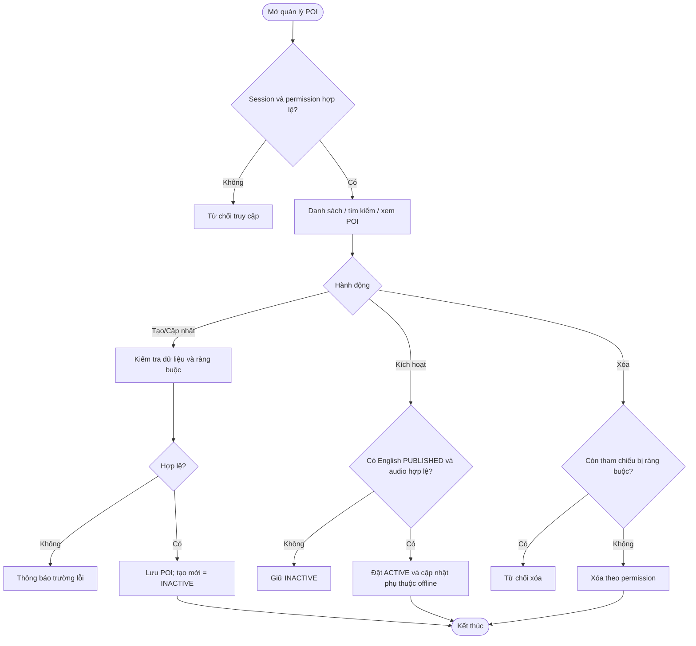
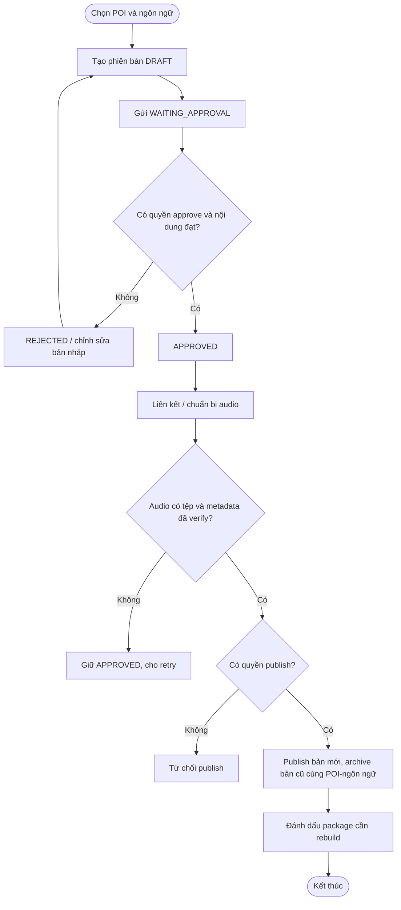

# UC-WEB-01 — Quản trị POI, nội dung thuyết minh và audio

| Use case number: | UC-WEB-01 |  |
| :---- | :---- | :---- |
| **Use case name:** | Quản trị POI, nội dung thuyết minh và audio |  |
| **Actor(s):** | Người quản trị nội dung có quyền tương ứng, Admin Web, MNR Backend |  |
| **Maturity:** | Specification / Target behavior — mô tả luồng nghiệp vụ mục tiêu; cần xác minh từng API và tích hợp tài nguyên audio trước khi đánh dấu Implemented. |  |
| **Summary:** | Quản lý vòng đời POI, phiên bản nội dung đa ngôn ngữ và metadata audio từ khâu tạo/hiệu chỉnh đến phê duyệt, xuất bản và phân phối công khai; bảo đảm không công bố dữ liệu chưa hợp lệ. **Traceability:** Epic: EP-W01 — POI and Narration Administration; Component / Priority: Web Administration / P0; Features: FT-W01 POI Management; FT-W02 Narration Content Management; FT-W03 Audio Management; Requirements: FR-W02; FR-W03; FR-W04; User Stories: US-W01–US-W08 |  |
| **Basic Course of Events:** | **Actor action** | **System response** |
|  | **FT-W01 — Quản lý POI** |  |
|  | 1\. Người quản trị mở danh sách POI; backend kiểm tra session và permission `read`. |  |
|  | 2\. Người quản trị tìm kiếm/lọc/phân trang, xem chi tiết POI và dữ liệu khu vực, danh mục. |  |
|  |  | 3\. Chọn tạo POI; nhập `region_id`, `poi_name`, `poi_location`, `poi_image_url`, `poi_qr_code`, tọa độ và `trigger_radius_meter`. |
|  |  | 4\. Backend kiểm tra bắt buộc, tọa độ trong miền hợp lệ, bán kính dương, mã QR/địa chỉ không trùng và khóa ngoại; tạo POI với `poi_status = INACTIVE` (**BR-03**). |
|  |  | 5\. Khi cập nhật, backend kiểm tra permission, tham chiếu và quy tắc toàn vẹn dữ liệu. |
|  |  | 6\. Khi yêu cầu kích hoạt, backend chỉ chuyển sang `ACTIVE` nếu POI có ít nhất một phiên bản tiếng Anh `PUBLISHED` và audio metadata/tài nguyên hợp lệ (**BR-04**). |
|  |  | 7\. Khi vô hiệu hóa, POI ngừng xuất hiện ở API công khai online; thay đổi dữ liệu mobile-relevant đánh dấu package liên quan cần rebuild. |
|  |  | 8\. Khi xóa, backend từ chối nếu còn tham chiếu nội dung, lịch sử nghe hoặc package vi phạm ràng buộc (**BR-11**). |
|  | **FT-W02 — Quản lý nội dung và xuất bản** |  |
|  | 1\. Từ một POI, người quản trị chọn ngôn ngữ đã đăng ký và tạo nội dung `narration_title`, `narration_script`. |  |
|  |  | 2\. Backend tạo `Poi_Content` mới ở `DRAFT` với `content_version` tăng trong phạm vi `poi_id + language_id`; không ghi đè bản đang PUBLISHED. |
|  | 3\. Người có quyền gửi `WAITING_APPROVAL`; reviewer có permission tương ứng phê duyệt thành `APPROVED` hoặc từ chối (`REJECTED` theo state machine). |  |
|  |  | 4\. Trước khi publish, hệ thống yêu cầu audio hợp lệ gắn với đúng phiên bản content; nếu có quy trình TTS khi publish thì tạo file, upload và xác minh trước khi đổi trạng thái. |
|  |  | 5\. Khi mọi điều kiện đạt và permission `publish` hợp lệ, backend chuyển bản mới thành `PUBLISHED`, lưu thông tin người/thời điểm xuất bản. |
|  |  | 6\. Bản PUBLISHED trước của cùng cặp POI-ngôn ngữ được chuyển `ARCHIVED` trong xử lý nhất quán; đánh dấu package offline bị ảnh hưởng cần rebuild. |
|  |  | 7\. Nếu đây là tiếng Anh cho POI ACTIVE, phải bảo đảm quá trình thay phiên bản không tạo khoảng trống bản tiếng Anh khả dụng. |
|  | **FT-W03 — Quản lý metadata audio** |  |
|  | 1\. Người có quyền mở phiên bản content và trang quản lý audio. |  |
|  |  | 2\. Hệ thống hiển thị `audio_source_type` (`RECORD` hoặc `TTS`), `audio_url`, `audio_mime_type`, `audio_size`, `audio_duration_sec`, `audio_checksum_sha256`. |
|  |  | 3\. Trước khi gắn/thay audio, hệ thống kiểm tra tính hợp lệ của metadata và xác minh tài nguyên vật lý qua cơ chế tích hợp thích hợp. |
|  |  | 4\. Mỗi `poi_content_id` có tối đa một `Content_Audio` trong thiết kế hiện tại. |
|  |  | 5\. Nếu thay audio, phải dùng asset URL bất biến phù hợp checksum; đánh dấu các package tham chiếu nội dung cần rebuild. |
|  |  | 6\. Chỉ metadata **không** chứng minh tệp đã upload/verify; không publish dựa trên bản ghi chưa kiểm chứng. |
| **Alternative Paths:** | **A1 — Quản trị POI:** Đăng nhập có permission phù hợp để xem, tạo/cập nhật, kích hoạt/vô hiệu hóa hoặc xóa POI theo điều kiện nghiệp vụ.  **A2 — Quản trị content:** Tạo phiên bản DRAFT, gửi phê duyệt, phê duyệt/từ chối và xuất bản theo phân quyền.  **A3 — Quản trị audio:** Kiểm tra hoặc thay metadata và tài nguyên audio liên kết phiên bản content trước khi publish. |  |
| **Exception Paths:** | **E1 — Session hết hạn/không có permission:** Từ chối hành động tại backend; không chỉ ẩn nút trên web.  **E2 — Tạo POI dữ liệu không hợp lệ/trùng QR:** Thông báo trường lỗi; không tạo bản ghi.  **E3 — Kích hoạt POI thiếu English PUBLISHED/audio:** Giữ INACTIVE và giải thích điều kiện thiếu.  **E4 — Xóa POI vẫn bị tham chiếu:** Từ chối xóa để giữ toàn vẹn dữ liệu.  **E5 — Content chưa APPROVED hoặc audio thiếu:** Từ chối publish; giữ phiên bản đang phục vụ.  **E6 — TTS/upload/verify audio thất bại:** Giữ content APPROVED; không archive bản PUBLISHED trước.  **E7 — Publish phiên bản mới:** Archive bản cũ của cùng POI-ngôn ngữ; không ảnh hưởng ngôn ngữ khác.  **E8 — Thay đổi POI/content/audio làm package stale:** Đánh dấu rebuild; không coi package BUILDING là đã sẵn sàng tải. |  |
| **Extension Points:** | Có thể bổ sung hệ thống xử lý TTS/upload file thực tế, audit event và quy trình rebuild package tự động. |  |
| **Triggers:** | Người quản trị muốn tạo/cập nhật POI, quản lý phiên bản nội dung hoặc audio và xuất bản. |  |
| **Assumptions:** | Permission quản trị được backend kiểm tra; tệp audio phải xác minh riêng với metadata. |  |
| **Preconditions:** | Người quản trị đã đăng nhập, session còn hợp lệ và có permission tương ứng với hành động create/read/update/delete/approve/publish. |  |
| **Post Conditions:** | Dữ liệu được lưu/đổi trạng thái hợp lệ; nội dung PUBLISHED có audio hợp lệ; POI ACTIVE chỉ tồn tại khi có bản tiếng Anh PUBLISHED và audio phù hợp. |  |
| **Preferences:** | Ưu tiên bảo đảm quyền riêng tư, không khai báo chức năng đã triển khai khi mới ở mức thiết kế; xử lý nguồn dữ liệu/phiên bản đúng PRD và database contract. |  |
| **Author(s):** | MNR Documentation Team |  |
| **Date:** | 09-11-2026 |  |

## Business Rules and Acceptance Criteria

**BR-02–04, BR-09, BR-11:** Chỉ ACTIVE công khai; POI mới INACTIVE; điều kiện English + audio; RBAC backend; ràng buộc delete.  **AC-W01-01:** US-W01–03 quản lý POI hợp lệ, tìm kiếm/lọc và từ chối kích hoạt/xóa sai quy tắc.  **AC-W01-02:** US-W04–05 tạo bản DRAFT/version mới mà không ghi đè bản đã publish.  **AC-W01-03:** US-W06 chỉ người có quyền duyệt/publish chuyển trạng thái; content không được PUBLISHED thiếu audio hợp lệ.  **AC-W01-04:** US-W07–08 hiển thị và kiểm tra metadata đúng content; phân biệt RECORD/TTS.  **AC-W01-05:** Khi publish bản mới, bản đang PUBLISHED trước đó được ARCHIVED nhất quán; package liên quan cần rebuild.  **AC-W01-06:** Đối với POI ACTIVE, hệ thống không cho phép thay đổi làm mất bản tiếng Anh PUBLISHED với audio hợp lệ.

## Activity Diagram

Activity Diagram — POI Administration

## Traceability, Data and Implementation Notes

- **Nguồn dữ liệu:** - **Hậu điều kiện thành công:** Dữ liệu được lưu/đổi trạng thái hợp lệ; nội dung PUBLISHED có audio hợp lệ; POI ACTIVE chỉ tồn tại khi có bản tiếng Anh PUBLISHED và audio phù hợp. `Point_Of_Interests`, `Poi_Category_Mapping`, `Regions`, `Poi_Categories`, `Languages`, `Poi_Contents`, `Content_Audios`, `Offline_Packages`, `Offline_Package_Items`; audit log là yêu cầu hệ thống.
- **Liên kết:** Traceability and Notes
- EP-W01 chỉ bao gồm FT-W01, FT-W02, FT-W03 theo PRD §3.3.2; xác thực/phiên quản trị thuộc EP-W02.
- Quy trình TTS/upload/verify file được mô tả như **luồng tích hợp mục tiêu**; không khẳng định chỉ từ metadata rằng file đã được tạo thực tế.
- PRD FR-W03 có nghiệp vụ gỡ bỏ nội dung; chuyển trạng thái/gỡ bỏ phải bảo toàn quy tắc English narration của POI ACTIVE và phiên bản đang phân phối.
- Nguồn: PRD.md FR-W02–04, US-W01–08, BR-02–04/09/11; `docs/database-design.md` §2.2–2.3.
- **Nguồn tham khảo:** PRD.md (§2.3, §3.3–3.4); `docs/database-design.md`; mẫu bố cục `docs/usecase/authentication-session.md`.
