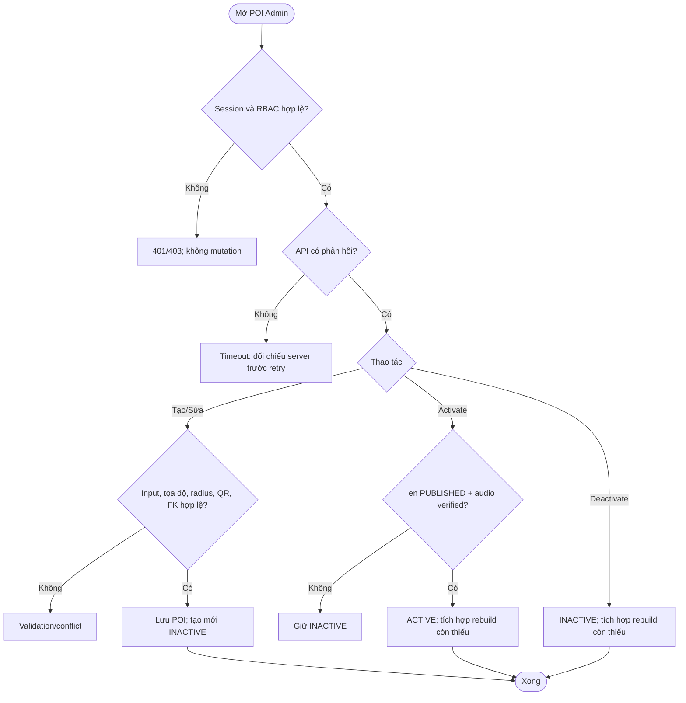
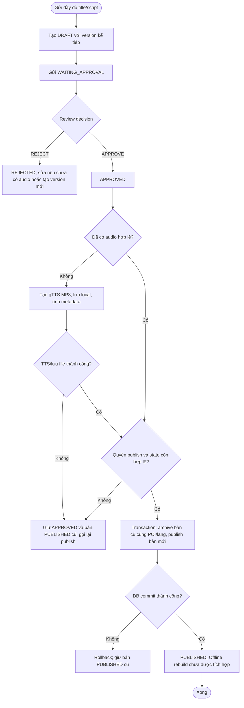
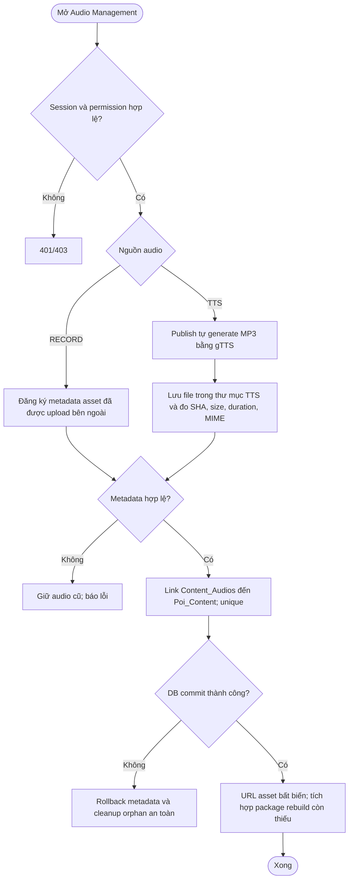

# UC-WEB-01 — Quản trị POI, nội dung thuyết minh và audio

| Use case number: | UC-WEB-01 |  |
| :---- | :---- | :---- |
| **Use case name:** | Quản trị POI, nội dung thuyết minh và audio |  |
| **Actor(s):** | Người quản trị nội dung có quyền tương ứng, Admin Web, MNR Backend |  |
| **Maturity:** | Backend implemented cho quản trị POI, content workflow, metadata RECORD và TTS local khi publish. Upload ảnh/RECORD, xác minh file từ storage, Audit và Offline package rebuild vẫn là phần tích hợp chưa triển khai. |  |
| **Summary:** | Quản lý vòng đời POI, phiên bản nội dung đa ngôn ngữ và metadata audio từ khâu tạo/hiệu chỉnh đến phê duyệt, xuất bản và phân phối công khai; bảo đảm không công bố dữ liệu chưa hợp lệ. **Traceability:** Epic: EP-W01 — POI and Narration Administration; Component / Priority: Web Administration / P0; Features: FT-W01 POI Management; FT-W02 Narration Content Management; FT-W03 Audio Management; Requirements: FR-W02; FR-W03; FR-W04; User Stories: US-W01–US-W08 |  |
| **Basic Course of Events:** | **Actor action** | **System response** |
|  | 1\. Quản trị viên mở POI Management. |  |
|  |  | 2\. Backend xác minh session và RBAC, trả danh sách hoặc lỗi API. **E1, E2, E3** |
|  | 3\. Quản trị viên nhập thông tin tạo/sửa POI. |  |
|  |  | 4\. Kiểm tra tọa độ, radius, QR UNIQUE, FK; tạo POI mặc định INACTIVE. **A1, E4** |
|  | 5\. Quản trị viên kích hoạt hoặc vô hiệu hóa POI. |  |
|  |  | 6\. Yêu cầu ACTIVE phải có en PUBLISHED + metadata audio hợp lệ. Phiên bản hiện tại không cung cấp hard delete POI. **A2, E6** |
|  | 7\. Quản trị viên tạo nội dung theo POI và ngôn ngữ. |  |
|  |  | 8\. Tạo mới toàn bộ DRAFT với version kế tiếp, giữ PUBLISHED cũ; submit và gửi một quyết định review APPROVE/REJECT có kiểm tra quyền. **A3, E3, E7** |
|  | 9\. Quản trị viên có thể đăng ký metadata RECORD, hoặc yêu cầu publish mà chưa có audio. |  |
|  |  | 10\. Nếu chưa có audio hợp lệ, backend tạo MP3 bằng gTTS, lưu vào thư mục TTS đã cấu hình và tính checksum, MIME, size, duration. **A4, E8, E11** |
|  |  | 11\. Transaction archive bản cũ cùng POI/lang và publish bản mới; rollback nếu lỗi, bảo vệ bản en cho POI ACTIVE. **A5, E9** |
|  |  | 12\. Tích hợp đánh dấu/rebuild Offline package chưa được triển khai; package hiện tại không tự thay đổi theo thao tác publish. **E10** |
| **Alternative Paths:** | **A1 — Quản lý POI và sửa metadata:** Người có quyền tạo/sửa POI; chỉ POI hợp lệ được lưu, POI mới luôn INACTIVE.  **A2 — Kích hoạt và vô hiệu hóa POI:** Khi kích hoạt phải có nội dung en PUBLISHED + metadata audio hợp lệ; khi vô hiệu hóa, API online không trả POI. Rebuild package liên quan là phần tích hợp còn thiếu.  **A3 — Tạo phiên bản nội dung mới:** Client gửi đầy đủ title/script; backend tạo DRAFT với `max(version) + 1`, không sao chép nội dung cũ và không ghi đè bản đã publish.  **A4 — Audio RECORD/TTS:** RECORD hiện nhận metadata của asset do hệ thống ngoài upload; nếu publish chưa có audio hợp lệ, backend tự tạo TTS và lưu file MP3 cục bộ trong cây source được cấu hình.  **A5 — Xuất bản phiên bản mới:** Chuyển phiên bản cũ cùng POI/ngôn ngữ sang ARCHIVED nhất quán; bảo đảm POI ACTIVE không mất bản en PUBLISHED hợp lệ. |  |
| **Exception Paths:** | **E1 — Không có mạng đến Admin API/timeout/HTTP 5xx:** Thông báo yêu cầu chưa được xác nhận; không tự giả định ghi thành công, tải lại trạng thái server khi có mạng trước khi retry để tránh tạo dữ liệu trùng.  **E2 — JWT/session hết hạn hoặc bị thu hồi:** Trả 401; đăng nhập/làm mới phiên theo EP-W02, không thực hiện mutation trước khi xác thực hợp lệ.  **E3 — Không có permission cho hành động:** Backend trả 403; không sửa database, dù giao diện có hiển thị thao tác.  **E4 — POI thiếu trường, tọa độ ngoài [-90,90]/[-180,180], bán kính không dương, QR/địa chỉ trùng:** Trả validation/conflict; không tạo hoặc cập nhật bản ghi không hợp lệ.  **E5 — DRAFT/REJECTED đã có audio:** Không sửa trực tiếp title/script; tạo một content version mới đầy đủ để tránh metadata audio lệch nội dung.  **E6 — Bật ACTIVE nhưng thiếu bản tiếng Anh PUBLISHED hoặc audio hợp lệ:** Giữ INACTIVE và chỉ rõ điều kiện còn thiếu.  **E7 — Review/publish sai trạng thái, thiếu quyền, hoặc phiên bản thay đổi trong lúc tạo TTS:** Không xuất bản; tải lại state và retry đúng bước.  **E8 — gTTS/lưu file thất bại:** Giữ content APPROVED, bản PUBLISHED cũ tiếp tục phục vụ, không archive; gọi lại publish để retry.  **E9 — Publish/đổi ARCHIVED hoặc ghi DB lỗi giữa transaction:** Rollback để không có hai bản PUBLISHED hoặc mất bản đang phân phối; thông báo lỗi và tải lại trạng thái.  **E10 — Offline package:** Việc đánh dấu/rebuild chưa nối vào publish; không được coi package hiện tại đã tự đồng bộ.  **E11 — RECORD chỉ có metadata:** Backend hiện chưa tải file từ URL để xác minh bytes/checksum; đây là giới hạn tích hợp, không nên mô tả là file đã VERIFIED. |  |
| **Extension Points:** | Có thể thay gTTS/local asset storage bằng provider và object storage production, đồng thời bổ sung audit event và quy trình rebuild package tự động. |  |
| **Triggers:** | Người quản trị muốn tạo/cập nhật POI, quản lý phiên bản nội dung hoặc audio và xuất bản. |  |
| **Assumptions:** | Permission quản trị được backend kiểm tra. TTS local được tạo và đo trực tiếp; RECORD hiện chỉ đăng ký metadata và cần storage/upload pipeline xác minh ở bước tích hợp production. |  |
| **Preconditions:** | Tác nhân quản trị có tài khoản phù hợp; session và permission được kiểm tra tại backend cho từng thao tác, thiếu quyền theo E2/E3. |  |
| **Post Conditions:** | Dữ liệu được lưu/đổi trạng thái hợp lệ; nội dung PUBLISHED có audio hợp lệ; POI ACTIVE chỉ tồn tại khi có bản tiếng Anh PUBLISHED và audio phù hợp. |  |
| **Preferences:** | Ưu tiên bảo đảm quyền riêng tư, không khai báo chức năng đã triển khai khi mới ở mức thiết kế; xử lý nguồn dữ liệu/phiên bản đúng PRD và database contract. |  |
| **Author(s):** | MNR Documentation Team |  |
| **Date:** | 09-11-2026 |  |

## Business Rules and Acceptance Criteria

**BR-02–04, BR-09:** Chỉ ACTIVE công khai; POI mới INACTIVE; điều kiện English + audio; RBAC backend; không hard delete POI/content/audio.  **AC-W01-01:** US-W01–03 quản lý POI hợp lệ, tìm kiếm/lọc và từ chối kích hoạt sai quy tắc.  **AC-W01-02:** US-W04–05 tạo một DRAFT đầy đủ với version mới mà không sao chép hay ghi đè bản đã publish.  **AC-W01-03:** US-W06 chỉ người có quyền submit/review/publish chuyển trạng thái; review dùng một quyết định APPROVE/REJECT; content không được PUBLISHED thiếu audio hợp lệ.  **AC-W01-04:** US-W07–08 hiển thị metadata đúng content; phân biệt RECORD/TTS; TTS local được tạo tự động nếu publish chưa có audio.  **AC-W01-05:** Khi publish bản mới, bản đang PUBLISHED trước đó được ARCHIVED nhất quán; tích hợp rebuild package còn thiếu.  **AC-W01-06:** Đối với POI ACTIVE, hệ thống không cho phép thay đổi làm mất bản tiếng Anh PUBLISHED với audio hợp lệ.

## Activity Diagrams

### POI Administration

### Narration Publication

### Audio Management

## Traceability, Data and Implementation Notes

- **Dependencies:** FT-W01/W02/W03; session và RBAC thuộc EP-W02.
- **Sources:** `PRD.md` (Feature/Requirement/User Story), `docs/database-design.md` (database contract), template `docs/usecase/authentication-session.md`.
- **Maturity:** Luồng backend POI/content/review/publish/TTS local đã triển khai. Upload/xác minh asset bên ngoài, Audit, Offline rebuild và object storage production chưa triển khai.

## Exception Acceptance Scenarios

- **AT-EP01**: API timeout: đối chiếu server trước retry mutation.
- **AT-EP02**: Backend 401/403: không ghi thay đổi.
- **AT-EP03**: POI thiếu en PUBLISHED + verified audio: không ACTIVE.
- **AT-EP04**: TTS/upload/verify lỗi: bản PUBLISHED trước còn phục vụ.
- **AT-EP05**: Publish transaction lỗi: rollback nhất quán.
- **AT-EP06**: Rebuild package lỗi: giữ version PUBLISHED cũ.
- **AT-EP07**: TTS sinh file bất biến trong storage đã cấu hình; RECORD vẫn cần pipeline upload/xác minh production.
