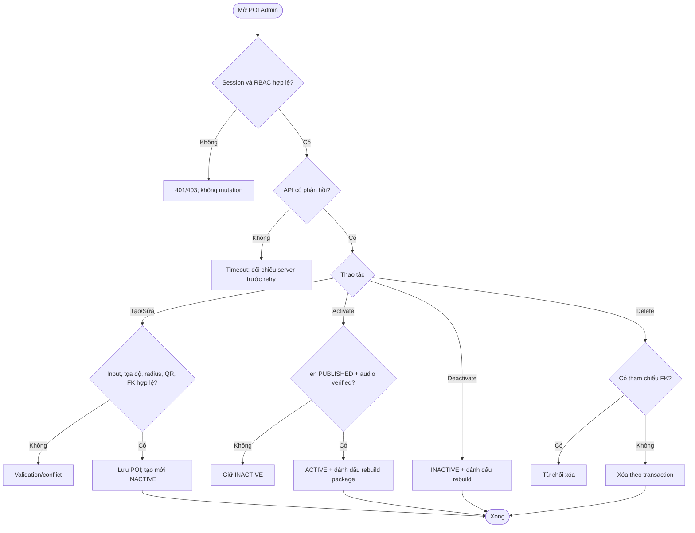
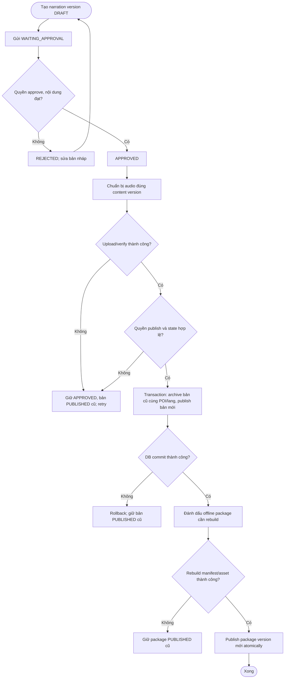
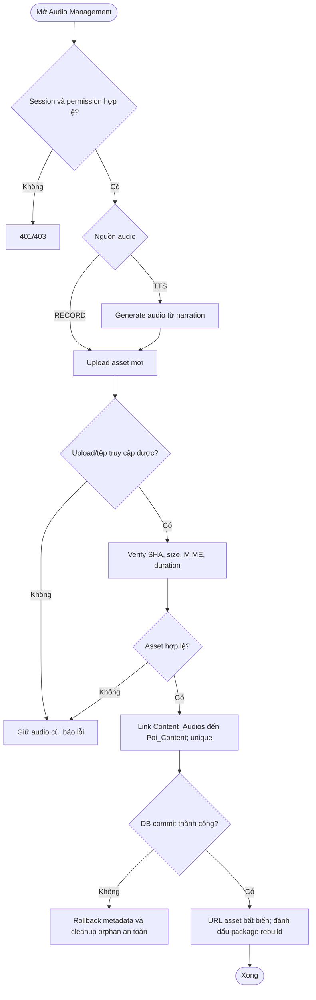

# UC-WEB-01 — Quản trị POI, nội dung thuyết minh và audio

| Use case number: | UC-WEB-01 |  |
| :---- | :---- | :---- |
| **Use case name:** | Quản trị POI, nội dung thuyết minh và audio |  |
| **Actor(s):** | Người quản trị nội dung có quyền tương ứng, Admin Web, MNR Backend |  |
| **Maturity:** | Specification / Target behavior — mô tả luồng nghiệp vụ mục tiêu; cần xác minh từng API và tích hợp tài nguyên audio trước khi đánh dấu Implemented. |  |
| **Summary:** | Quản lý vòng đời POI, phiên bản nội dung đa ngôn ngữ và metadata audio từ khâu tạo/hiệu chỉnh đến phê duyệt, xuất bản và phân phối công khai; bảo đảm không công bố dữ liệu chưa hợp lệ. **Traceability:** Epic: EP-W01 — POI and Narration Administration; Component / Priority: Web Administration / P0; Features: FT-W01 POI Management; FT-W02 Narration Content Management; FT-W03 Audio Management; Requirements: FR-W02; FR-W03; FR-W04; User Stories: US-W01–US-W08 |  |
| **Basic Course of Events:** | **Actor action** | **System response** |
|  | 1\. Quản trị viên mở POI Management. |  |
|  |  | 2\. Backend xác minh session và RBAC, trả danh sách hoặc lỗi API. **E1, E2, E3** |
|  | 3\. Quản trị viên nhập thông tin tạo/sửa POI. |  |
|  |  | 4\. Kiểm tra tọa độ, radius, QR UNIQUE, FK; tạo POI mặc định INACTIVE. **A1, E4** |
|  | 5\. Quản trị viên kích hoạt/vô hiệu hóa hoặc xóa POI. |  |
|  |  | 6\. Yêu cầu ACTIVE phải có en PUBLISHED + audio verify; xóa phải kiểm tra FK; metadata thay đổi gây rebuild package. **A2, E5, E6, E10** |
|  | 7\. Quản trị viên tạo nội dung theo POI và ngôn ngữ. |  |
|  |  | 8\. Tạo DRAFT version mới, giữ PUBLISHED cũ; theo quy trình approve/reject có kiểm tra quyền. **A3, E3, E7** |
|  | 9\. Quản trị viên chuẩn bị RECORD/TTS và yêu cầu publish. |  |
|  |  | 10\. Kiểm tra upload, checksum, MIME, size, URL bất biến và content APPROVED. **A4, E8, E11** |
|  |  | 11\. Transaction archive bản cũ cùng POI/lang và publish bản mới; rollback nếu lỗi, bảo vệ bản en cho POI ACTIVE. **A5, E9** |
|  |  | 12\. Đánh dấu package rebuild; lỗi rebuild phải giữ package đã PUBLISHED. **E10** |
| **Alternative Paths:** | **A1 — Quản lý POI và sửa metadata:** Người có quyền tạo/sửa POI; chỉ POI hợp lệ được lưu, POI mới luôn INACTIVE.  **A2 — Kích hoạt và vô hiệu hóa POI:** Khi kích hoạt phải có nội dung en PUBLISHED + audio thực sự hợp lệ; khi vô hiệu hóa, API online không trả POI và package liên quan cần rebuild.  **A3 — Tạo phiên bản nội dung mới:** Giữ bản PUBLISHED cũ đang phân phối trong khi bản mới DRAFT/WAITING_APPROVAL/APPROVED; không ghi đè version cũ.  **A4 — Thay audio RECORD/TTS:** Upload tài nguyên mới trước, xác minh SHA-256/MIME/size/duration và URL bất biến rồi liên kết metadata; đánh dấu offline package liên quan cần rebuild.  **A5 — Xuất bản phiên bản mới:** Chuyển phiên bản cũ cùng POI/ngôn ngữ sang ARCHIVED nhất quán; bảo đảm POI ACTIVE không mất bản en PUBLISHED hợp lệ. |  |
| **Exception Paths:** | **E1 — Không có mạng đến Admin API/timeout/HTTP 5xx:** Thông báo yêu cầu chưa được xác nhận; không tự giả định ghi thành công, tải lại trạng thái server khi có mạng trước khi retry để tránh tạo dữ liệu trùng.  **E2 — JWT/session hết hạn hoặc bị thu hồi:** Trả 401; đăng nhập/làm mới phiên theo EP-W02, không thực hiện mutation trước khi xác thực hợp lệ.  **E3 — Không có permission cho hành động:** Backend trả 403; không sửa database, dù giao diện có hiển thị thao tác.  **E4 — POI thiếu trường, tọa độ ngoài [-90,90]/[-180,180], bán kính không dương, QR/địa chỉ trùng:** Trả validation/conflict; không tạo hoặc cập nhật bản ghi không hợp lệ.  **E5 — Xóa POI còn quan hệ content/history/offline package:** Từ chối xóa theo ràng buộc tham chiếu BR-11; giữ nguyên dữ liệu liên quan.  **E6 — Bật ACTIVE nhưng thiếu bản tiếng Anh PUBLISHED hoặc audio hợp lệ:** Giữ INACTIVE và chỉ rõ điều kiện còn thiếu.  **E7 — Content chưa APPROVED, role không có quyền approve/publish, hoặc phiên bản đã thay đổi:** Không xuất bản; yêu cầu kiểm tra lại state và quyền ở backend.  **E8 — TTS/upload/file verification thất bại:** Giữ content APPROVED, bản PUBLISHED cũ tiếp tục phục vụ, không archive, cho retry bước tạo audio.  **E9 — Publish/đổi ARCHIVED hoặc ghi DB lỗi giữa transaction:** Rollback để không có hai bản PUBLISHED hoặc mất bản đang phân phối; thông báo lỗi và tải lại trạng thái.  **E10 — Offline package rebuild thất bại:** Không công bố manifest BUILDING/FAILED; bản PUBLISHED cũ và local READY cũ tiếp tục sử dụng.  **E11 — Audio metadata tồn tại nhưng file thiếu/checksum sai:** Không chấp nhận tài nguyên chưa VERIFIED khi publish; không đánh đồng metadata với upload thực tế. |  |
| **Extension Points:** | Có thể bổ sung hệ thống xử lý TTS/upload file thực tế, audit event và quy trình rebuild package tự động. |  |
| **Triggers:** | Người quản trị muốn tạo/cập nhật POI, quản lý phiên bản nội dung hoặc audio và xuất bản. |  |
| **Assumptions:** | Permission quản trị được backend kiểm tra; tệp audio phải xác minh riêng với metadata. |  |
| **Preconditions:** | Tác nhân quản trị có tài khoản phù hợp; session và permission được kiểm tra tại backend cho từng thao tác, thiếu quyền theo E2/E3. |  |
| **Post Conditions:** | Dữ liệu được lưu/đổi trạng thái hợp lệ; nội dung PUBLISHED có audio hợp lệ; POI ACTIVE chỉ tồn tại khi có bản tiếng Anh PUBLISHED và audio phù hợp. |  |
| **Preferences:** | Ưu tiên bảo đảm quyền riêng tư, không khai báo chức năng đã triển khai khi mới ở mức thiết kế; xử lý nguồn dữ liệu/phiên bản đúng PRD và database contract. |  |
| **Author(s):** | MNR Documentation Team |  |
| **Date:** | 09-11-2026 |  |

## Business Rules and Acceptance Criteria

**BR-02–04, BR-09, BR-11:** Chỉ ACTIVE công khai; POI mới INACTIVE; điều kiện English + audio; RBAC backend; ràng buộc delete.  **AC-W01-01:** US-W01–03 quản lý POI hợp lệ, tìm kiếm/lọc và từ chối kích hoạt/xóa sai quy tắc.  **AC-W01-02:** US-W04–05 tạo bản DRAFT/version mới mà không ghi đè bản đã publish.  **AC-W01-03:** US-W06 chỉ người có quyền duyệt/publish chuyển trạng thái; content không được PUBLISHED thiếu audio hợp lệ.  **AC-W01-04:** US-W07–08 hiển thị và kiểm tra metadata đúng content; phân biệt RECORD/TTS.  **AC-W01-05:** Khi publish bản mới, bản đang PUBLISHED trước đó được ARCHIVED nhất quán; package liên quan cần rebuild.  **AC-W01-06:** Đối với POI ACTIVE, hệ thống không cho phép thay đổi làm mất bản tiếng Anh PUBLISHED với audio hợp lệ.

## Activity Diagrams

### POI Administration

### Narration Publication

### Audio Management

## Traceability, Data and Implementation Notes

- **Dependencies:** FT-W01/W02/W03; session và RBAC thuộc EP-W02.
- **Sources:** `PRD.md` (Feature/Requirement/User Story), `docs/database-design.md` (database contract), template `docs/usecase/authentication-session.md`.
- **Maturity:** Target behavior / đặc tả, không khẳng định tính năng đã chạy trên client và backend.

## Exception Acceptance Scenarios

- **AT-EP01**: API timeout: đối chiếu server trước retry mutation.
- **AT-EP02**: Backend 401/403: không ghi thay đổi.
- **AT-EP03**: POI thiếu en PUBLISHED + verified audio: không ACTIVE.
- **AT-EP04**: TTS/upload/verify lỗi: bản PUBLISHED trước còn phục vụ.
- **AT-EP05**: Publish transaction lỗi: rollback nhất quán.
- **AT-EP06**: Rebuild package lỗi: giữ version PUBLISHED cũ.
- **AT-EP07**: Thay RECORD/TTS cần asset bất biến và rebuild package.
