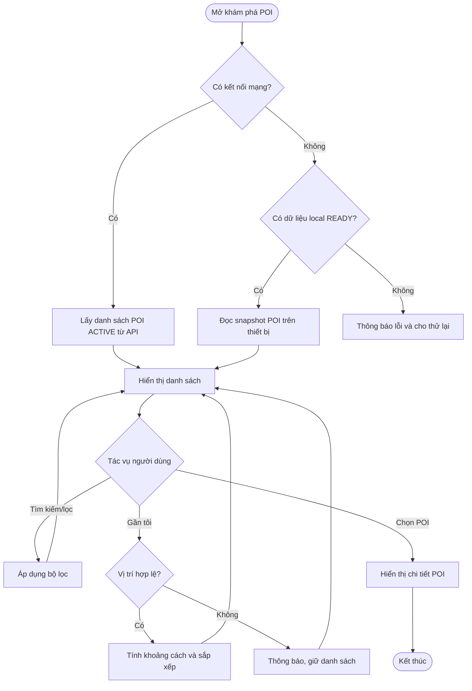

# FT-M01 — Point of Interest Discovery

## 1. Overview

| Thuộc tính | Giá trị |
| --- | --- |
| Epic | EP-M01 — POI Discovery and Interactive Map |
| Feature | FT-M01 — Point of Interest Discovery |
| Requirement | FR-M01 |
| User Stories | US-M01, US-M02, US-M03 |
| Actor chính | Tourist (không yêu cầu đăng nhập) |
| Ưu tiên | P0 |

**Mục tiêu:** Cho phép du khách xem, tìm kiếm, mở chi tiết và khám phá POI lân cận mà không cần đăng nhập. Chức năng khám phá POI lân cận sử dụng khoảng cách đến vị trí thiết bị; bán kính khám phá **khác** `trigger_radius_meter` dành cho Geofence.

## 2. Preconditions and Postconditions

- **Tiền điều kiện:** Ứng dụng được mở; dữ liệu POI công khai truy cập được qua mạng hoặc có snapshot offline hợp lệ.
- **Hậu điều kiện thành công:** Hiển thị danh sách/chi tiết POI chính xác, người dùng có thể chuyển sang Map hoặc Narration Player; không thay đổi dữ liệu máy chủ.
- **Dữ liệu:** `Point_Of_Interests`, `Regions`, `Poi_Categories`, `Poi_Category_Mapping`; dữ liệu local tương ứng khi offline.

## 3. Main Flow

1. Du khách mở màn hình khám phá.
2. Ứng dụng kiểm tra kết nối và nguồn dữ liệu POI hợp lệ; ưu tiên dữ liệu công khai mới từ backend khi online, dùng snapshot đã tải khi offline.
3. Ứng dụng lấy danh sách POI có `poi_status = ACTIVE` từ API công khai, kèm metadata khu vực/danh mục.
4. Du khách nhập từ khóa hoặc chọn bộ lọc; danh sách cập nhật theo tiêu chí.
5. Du khách chọn một POI; ứng dụng hiển thị tên, ảnh, vị trí/địa chỉ, khu vực, danh mục và nội dung thuyết minh khả dụng.
6. Khi chọn “gần tôi”, ứng dụng xin quyền vị trí nếu chưa có, đọc mẫu vị trí đủ tin cậy và tính khoảng cách theo tọa độ POI.
7. Danh sách được sắp xếp theo khoảng cách nếu tính được; người dùng có thể mở bản đồ hoặc phát thuyết minh.

## 4. Alternative and Exception Flows

| Trường hợp | Xử lý |
| --- | --- |
| Từ chối quyền vị trí/GPS tắt | Vẫn hiển thị và tìm kiếm danh sách POI; ẩn khoảng cách, không ép buộc cấp quyền. |
| Kết nối lỗi, có package READY | Hiển thị POI thuộc snapshot local đã tải; thông báo dữ liệu có thể cũ. |
| Kết nối lỗi, không có dữ liệu local | Thông báo không tải được danh sách và cho phép thử lại. |
| Tìm kiếm không có kết quả | Hiển thị trạng thái rỗng và tùy chọn xóa bộ lọc. |
| POI bị chuyển INACTIVE | Không trả về trong truy vấn online mới; snapshot offline cũ có thể còn cho đến khi cập nhật. |
| Vị trí quá cũ hoặc độ chính xác kém | Không sử dụng để xếp POI “gần tôi”; chuyển sang danh sách thông thường. |

## 5. Business Rules and Acceptance Criteria

- **BR-01, BR-02:** Truy vấn công khai không yêu cầu đăng nhập và chỉ trả POI ACTIVE.
- **AC-M01-01:** US-M01 hiển thị danh sách POI ACTIVE; POI INACTIVE trên server không xuất hiện online.
- **AC-M01-02:** US-M02 tìm kiếm/lọc và mở đúng chi tiết POI được chọn.
- **AC-M01-03:** US-M03 chỉ hiển thị khoảng cách khi mẫu vị trí hợp lệ; từ chối quyền vị trí không chặn danh sách.
- **AC-M01-04:** Không dùng `trigger_radius_meter` làm bán kính lọc mặc định của khám phá lân cận.
- **AC-M01-05:** Offline chỉ dùng dữ liệu của package local đã commit READY, không giả định có toàn bộ danh mục POI.

## 6. Activity Diagram

## 7. Dependencies and Notes

- Liên kết FT-M02 (bản đồ), FT-M03 (phát thuyết minh), FT-M07 (snapshot offline).
- **Phạm vi thiết kế mục tiêu:** phần hiển thị gần tôi và đồng bộ dữ liệu local cần được đối chiếu khi tích hợp mobile; sơ đồ không khẳng định đã triển khai.
- Nguồn: PRD.md §2.3.1, §3.3–3.4; `docs/database-design.md` §2.2, §3–4.
