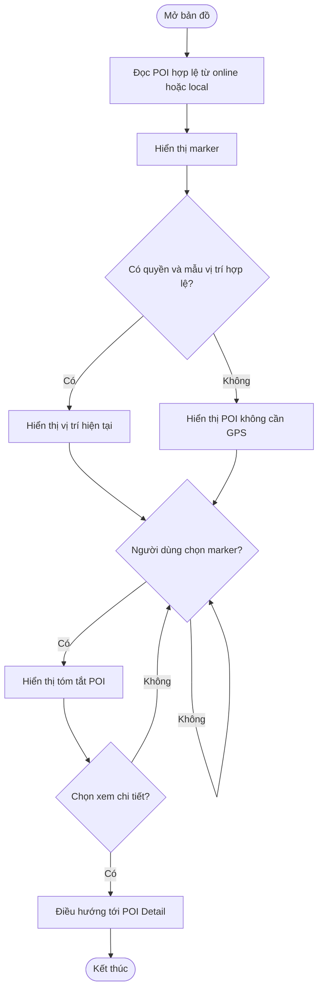

# FT-M02 — Interactive Map

## 1. Overview

| Thuộc tính | Giá trị |
| --- | --- |
| Epic | EP-M01 — POI Discovery and Interactive Map |
| Feature / Requirement | FT-M02 / FR-M02 |
| User Stories | US-M04, US-M05 |
| Actor | Tourist |
| Priority | P0 |

**Mục tiêu:** Hiển thị các POI trên bản đồ tương tác, vị trí người dùng khi được phép và điều hướng từ marker sang chi tiết POI. Không yêu cầu tài khoản du khách.

## 2. Preconditions / Postconditions

- **Tiền điều kiện:** Ứng dụng mở được màn hình bản đồ; dữ liệu POI có sẵn từ API hoặc snapshot local.
- **Hậu điều kiện:** Marker phản ánh đúng dữ liệu POI; chọn marker mở đúng POI; không thực hiện thay đổi dữ liệu.
- **Dữ liệu:** `Point_Of_Interests(latitude, longitude, poi_status, poi_name, trigger_radius_meter)`, `Local_POIs` (khi offline).

## 3. Main Flow

1. Người dùng mở bản đồ.
2. Ứng dụng tải dữ liệu POI ACTIVE khi online hoặc POI local thuộc package READY khi offline.
3. Ứng dụng hiển thị marker theo `latitude`, `longitude` và tên POI.
4. Nếu người dùng cho phép truy cập vị trí, ứng dụng nhận mẫu vị trí mới và hiển thị vị trí hiện tại.
5. Người dùng chạm marker; ứng dụng hiển thị tóm tắt POI và tùy chọn xem chi tiết.
6. Khi người dùng chọn xem chi tiết, ứng dụng mở đúng màn hình POI của FT-M01; từ đó có thể phát narration tại FT-M03.

## 4. Alternative / Exception Flows

| Trường hợp | Phản hồi |
| --- | --- |
| Quyền vị trí bị từ chối hoặc GPS tắt | Bản đồ vẫn hiển thị POI; không hiển thị vị trí hiện tại. |
| Mẫu vị trí stale/không chính xác | Không đưa ra khoảng cách hoặc gợi ý vị trí sai. |
| Không có mạng và tile map chưa cache | Có thể chuyển sang danh sách POI local; **không cam kết bản đồ nền offline**. |
| Không có dữ liệu POI hợp lệ | Hiển thị trạng thái trống hoặc yêu cầu tải trước dữ liệu. |
| POI thiếu tọa độ hợp lệ | Không tạo marker lỗi; ghi nhận để xử lý dữ liệu. |

## 5. Rules and Acceptance Criteria

- **BR-01, BR-02:** Chỉ lấy POI ACTIVE từ nguồn công khai online; offline phụ thuộc snapshot đã tải.
- **AC-M02-01:** US-M04 bản đồ có marker POI tương ứng tọa độ hợp lệ và vị trí thiết bị khi có quyền.
- **AC-M02-02:** US-M05 chạm marker POI A không mở nhầm POI B.
- **AC-M02-03:** Khi từ chối quyền vị trí, người dùng vẫn xem POI trên bản đồ.
- **AC-M02-04:** Mất mạng không dẫn đến tuyên bố sai rằng bản đồ nền đã tải; cung cấp danh sách POI local nếu có.

## 6. Activity Diagram

## 7. Dependencies / Notes

- FT-M01 cung cấp danh sách/chi tiết POI; FT-M07 cung cấp metadata offline.
- `trigger_radius_meter` phục vụ Geofence (FT-M05), không đồng nghĩa phạm vi hiển thị bản đồ.
- Nguồn: PRD.md §2.3.1, §3.3–3.4; `docs/database-design.md` §2.2, §3.
