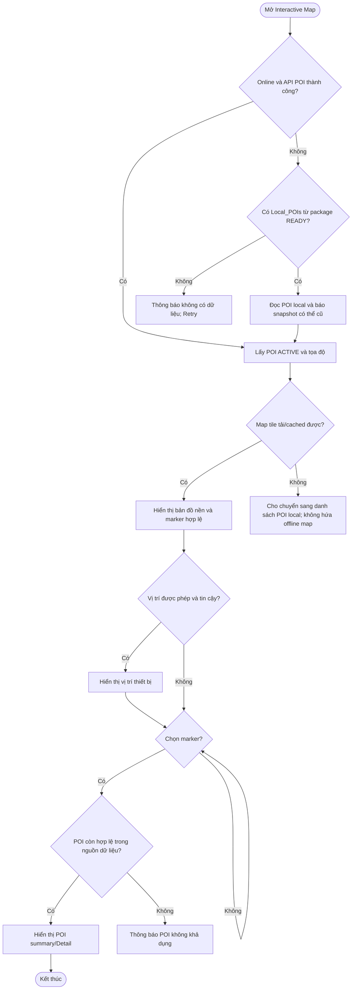

# UC-MOBILE-02 — Xem bản đồ tương tác

| Use case number: | UC-MOBILE-02 |  |
| :---- | :---- | :---- |
| **Use case name:** | Xem bản đồ tương tác |  |
| **Actor(s):** | Tourist (khách du lịch), Mobile Application |  |
| **Maturity:** | Specification / Target behavior — chức năng được đặc tả theo PRD và database design; chưa xác nhận toàn bộ luồng mobile đã triển khai. |  |
| **Summary:** | Hiển thị các POI trên bản đồ tương tác, vị trí người dùng khi được phép và điều hướng từ marker sang chi tiết POI. Không yêu cầu tài khoản du khách. **Traceability:** Epic: EP-M01 — POI Discovery and Interactive Map; Feature / Requirement: FT-M02 / FR-M02; User Stories: US-M04, US-M05; Priority: P0 |  |
| **Basic Course of Events:** | **Actor action** | **System response** |
|  | 1\. Người dùng mở bản đồ. |  |
|  |  | 2\. Ứng dụng tải dữ liệu POI ACTIVE khi online hoặc POI local thuộc package READY khi offline. **A2, A3, E1, E2** |
|  |  | 3\. Ứng dụng hiển thị marker theo `latitude`, `longitude` và tên POI. **E4** |
|  |  | 4\. Nếu người dùng cho phép truy cập vị trí, ứng dụng nhận mẫu vị trí mới và hiển thị vị trí hiện tại. **A1, E3** |
|  | 5\. Người dùng chạm marker POI. |  |
|  |  | 5a\. Ứng dụng hiển thị tóm tắt POI và tùy chọn xem chi tiết. |
|  | 6\. Khi người dùng chọn xem chi tiết, ứng dụng mở đúng màn hình POI của FT-M01; từ đó có thể phát narration tại FT-M03. |  |
| **Alternative Paths:** | **A1 — Không có quyền GPS:** Vẫn hiển thị marker POI, không định vị thiết bị; cho phép truy cập POI qua marker.  **A2 — Offline có POI local READY và tile bản đồ đã cache:** Dùng snapshot POI và hiển thị tile đã có khi nhà cung cấp bản đồ hỗ trợ.  **A3 — Offline thiếu tile nhưng có POI local READY:** Cho chuyển sang danh sách POI local; không cam kết hiển thị bản đồ nền. |  |
| **Exception Paths:** | **E1 — API POI lỗi hoặc hết thời gian chờ:** Thử lấy POI READY từ local; nếu không có dữ liệu, hiển thị lỗi/tùy chọn thử lại.  **E2 — Không có mạng, không có dữ liệu POI local:** Không có marker; hiển thị trạng thái thiếu dữ liệu và hướng dẫn tải gói khi online.  **E3 — GPS tắt, sample stale hoặc accuracy thấp:** Ẩn vị trí hiện tại/không tính khoảng cách; không định vị giả.  **E4 — POI không có tọa độ hợp lệ hoặc đã INACTIVE theo API:** Không tạo marker; không điều hướng tới POI không khả dụng. |  |
| **Extension Points:** | Có thể mở rộng theo các năng lực tích hợp mobile, backend và chính sách vận hành đã ghi trong PRD; không nằm trong phạm vi xác nhận triển khai hiện tại. |  |
| **Triggers:** | Người dùng mở màn hình bản đồ hoặc chạm marker POI. |  |
| **Assumptions:** | Nhà cung cấp bản đồ cần kết nối nếu map tiles chưa cache; không cam kết offline map tiles. |  |
| **Preconditions:** | Ứng dụng mở được màn hình bản đồ; dữ liệu POI có sẵn từ API hoặc snapshot local. |  |
| **Post Conditions:** | Marker phản ánh đúng dữ liệu POI; chọn marker mở đúng POI; không thực hiện thay đổi dữ liệu. |  |
| **Preferences:** | Ưu tiên bảo đảm quyền riêng tư, không khai báo chức năng đã triển khai khi mới ở mức thiết kế; xử lý nguồn dữ liệu/phiên bản đúng PRD và database contract. |  |
| **Author(s):** | MNR Documentation Team |  |
| **Date:** | 09-11-2026 |  |

## Business Rules and Acceptance Criteria

**Phạm vi:** Offline POI metadata không có nghĩa là offline basemap đã được tải. Dữ liệu Geofence `trigger_radius_meter` không quyết định marker nào được hiển thị.

**BR-01, BR-02:** Chỉ lấy POI ACTIVE từ nguồn công khai online; offline phụ thuộc snapshot đã tải.  **AC-M02-01:** US-M04 bản đồ có marker POI tương ứng tọa độ hợp lệ và vị trí thiết bị khi có quyền.  **AC-M02-02:** US-M05 chạm marker POI A không mở nhầm POI B.  **AC-M02-03:** Khi từ chối quyền vị trí, người dùng vẫn xem POI trên bản đồ.  **AC-M02-04:** Mất mạng không dẫn đến tuyên bố sai rằng bản đồ nền đã tải; cung cấp danh sách POI local nếu có.

## Activity Diagram

## Traceability, Data and Implementation Notes

- **Nguồn dữ liệu:** `Point_Of_Interests(latitude, longitude, poi_status, poi_name, trigger_radius_meter)`, `Local_POIs` (khi offline).
- **Liên kết:** Dependencies / Notes
- FT-M01 cung cấp danh sách/chi tiết POI; FT-M07 cung cấp metadata offline.
- `trigger_radius_meter` phục vụ Geofence (FT-M05), không đồng nghĩa phạm vi hiển thị bản đồ.
- Nguồn: PRD.md §2.3.1, §3.3–3.4; `docs/database-design.md` §2.2, §3.
- **Nguồn tham khảo:** PRD.md (§2.3, §3.3–3.4); `docs/database-design.md`; mẫu bố cục `docs/usecase/authentication-session.md`.
