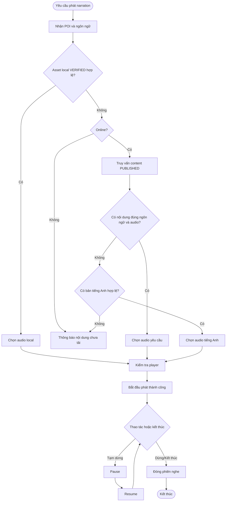

# UC-MOBILE-03 — Phát thuyết minh tại điểm tham quan

| Use case number: | UC-MOBILE-03 |  |
| :---- | :---- | :---- |
| **Use case name:** | Phát thuyết minh tại điểm tham quan |  |
| **Actor(s):** | Tourist (khách du lịch), Mobile Application |  |
| **Maturity:** | Specification / Target behavior — chức năng được đặc tả theo PRD và database design; chưa xác nhận toàn bộ luồng mobile đã triển khai. |  |
| **Summary:** | Phát đúng nội dung thuyết minh theo POI/ngôn ngữ lựa chọn, điều khiển pause/resume/stop; với **truy cập online**, fallback sang tiếng Anh nếu không có bản PUBLISHED và audio khả dụng bằng ngôn ngữ chọn. **Traceability:** Epic: EP-M02 — Narration Playback and QR Access; Feature / Requirement: FT-M03 / FR-M03; User Stories: US-M06, US-M07, US-M08; Priority: P0 |  |
| **Basic Course of Events:** | **Actor action** | **System response** |
|  |  | 1\. Nhận `poi_id` từ chi tiết POI, QR Code hoặc Geofence và ngôn ngữ người dùng lựa chọn. |
|  |  | 2\. Xác định nguồn phát: ưu tiên asset local **VERIFIED** thuộc package READY phù hợp khi khả dụng; nếu online có thể tra nội dung từ backend. |
|  |  | 3\. Đối với **online**, truy vấn phiên bản `PUBLISHED` theo ngôn ngữ yêu cầu; nếu không có audio hợp lệ, áp dụng fallback sang `en` (PRD BR-05). |
|  |  | 4\. Đối với **offline**, chỉ chọn nội dung theo ngôn ngữ của package đã tải; không tự bổ sung fallback khác ngôn ngữ (BR-06). |
|  |  | 5\. Kiểm tra audio metadata và quyền truy cập asset; nếu local, đối chiếu trạng thái xác minh; chuẩn bị player. |
|  |  | 6\. Bắt đầu phát một audio, cập nhật trạng thái `PLAYING`; ghi nhận listening event khi phát **thực sự bắt đầu** nếu dịch vụ đã được tích hợp. |
|  | 7\. Người dùng có thể `PAUSE`, `RESUME` hoặc `STOP`; khi hoàn tất hoặc dừng, cập nhật thời lượng nghe. |  |
| **Alternative Paths:** | **A1 — Không có PUBLISHED theo ngôn ngữ chọn (online):** Thử bản tiếng Anh PUBLISHED có audio hợp lệ; thông báo nếu vẫn không có.  **A2 — Offline không có asset đúng ngôn ngữ:** Thông báo cần tải gói phù hợp; không phát bản khác tiếng. |  |
| **Exception Paths:** | **E1 — Không có PUBLISHED theo ngôn ngữ chọn (online):** Thử bản tiếng Anh PUBLISHED có audio hợp lệ; thông báo nếu vẫn không có.  **E2 — Offline không có asset đúng ngôn ngữ:** Thông báo cần tải gói phù hợp; không phát bản khác tiếng.  **E3 — Audio local thiếu/hỏng checksum:** Không phát file chưa VERIFIED; gợi ý cập nhật/tải lại khi online.  **E4 — URL audio lỗi hoặc mất mạng:** Dừng/hiển thị lỗi; dùng local hợp lệ nếu sẵn có.  **E5 — Player đang phát nội dung khác:** Không chồng âm thanh; các yêu cầu auto được giữ làm pending và revalidate; yêu cầu thủ công xử lý theo chính sách chuyển phát của ứng dụng.  **E6 — TTS chưa có file audio:** Không giả định mobile tự tạo TTS; phát chỉ khi có audio khả dụng. |  |
| **Extension Points:** | Có thể mở rộng theo các năng lực tích hợp mobile, backend và chính sách vận hành đã ghi trong PRD; không nằm trong phạm vi xác nhận triển khai hiện tại. |  |
| **Triggers:** | Người dùng yêu cầu phát nội dung thuyết minh từ POI, QR hoặc Geofence. |  |
| **Assumptions:** | Audio được quản lý bởi tài nguyên có sẵn; mobile không tự sinh TTS khi thiếu tệp. |  |
| **Preconditions:** | POI xác định được; có nội dung và audio khả dụng từ package READY hoặc từ backend; ứng dụng có thể phát âm thanh. |  |
| **Post Conditions:** | Tối đa một audio đang phát tại một thời điểm; phiên phát được đóng khi kết thúc/dừng; nếu có logging thì trạng thái listening event nhất quán. |  |
| **Preferences:** | Ưu tiên bảo đảm quyền riêng tư, không khai báo chức năng đã triển khai khi mới ở mức thiết kế; xử lý nguồn dữ liệu/phiên bản đúng PRD và database contract. |  |
| **Author(s):** | MNR Documentation Team |  |
| **Date:** | 09-11-2026 |  |

## Business Rules and Acceptance Criteria

**BR-05, BR-06, BR-14:** Online có fallback tiếng Anh; offline không fallback; chỉ dùng local package đã xác minh.  **AC-M03-01:** US-M06 phát đúng `poi_id` và nội dung PUBLISHED/ngôn ngữ khả dụng.  **AC-M03-02:** US-M07 pause/resume/stop điều khiển đúng phiên, không tạo audio chồng.  **AC-M03-03:** US-M08 thiếu bản ngôn ngữ yêu cầu online thì chọn bản `en` hợp lệ.  **AC-M03-04:** Không gán thời điểm nghe hoặc cooldown khi player chưa bắt đầu phát thành công.  **AC-M03-05:** Khi offline, không tự động lấy tiếng Anh nếu package yêu cầu là ngôn ngữ khác.

## Activity Diagram

Activity Diagram

## Traceability, Data and Implementation Notes

- **Nguồn dữ liệu:** `Poi_Contents` (content_version, content_status, language_id); `Content_Audios` (audio_source_type, audio_url, audio_checksum_sha256); `Local_Assets`, `Local_Listening_Events`.
- **Liên kết:** Dependencies / Notes
- Phụ thuộc FT-M01/FT-M04/FT-M05 để xác định POI; FT-M07 để phát offline và FT-M08 để lấy ngôn ngữ.
- Phân biệt dữ liệu thiết kế và tình trạng triển khai; Listening History / đồng bộ sự kiện là yêu cầu tích hợp.
- Nguồn: PRD.md FR-M03, BR-05–06, BR-14, US-M06–08; `docs/database-design.md` §2.2.3–2.2.4, §3.2, §4.2.
- **Nguồn tham khảo:** PRD.md (§2.3, §3.3–3.4); `docs/database-design.md`; mẫu bố cục `docs/usecase/authentication-session.md`.
