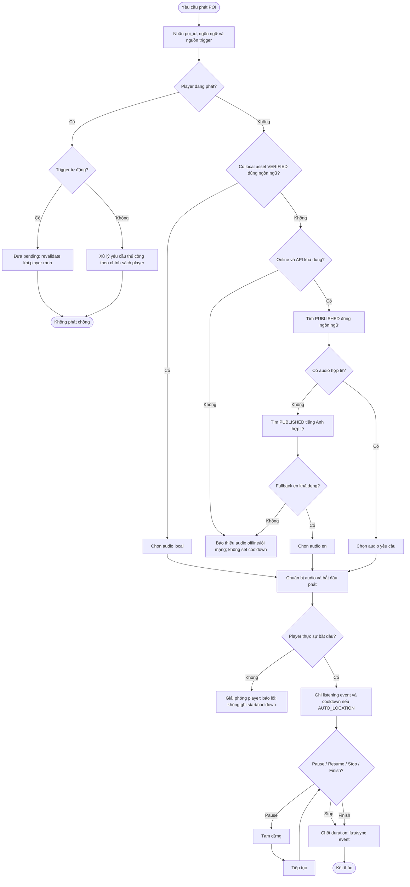

# UC-MOBILE-03 — Phát thuyết minh tại điểm tham quan

| Use case number: | UC-MOBILE-03 |  |
| :---- | :---- | :---- |
| **Use case name:** | Phát thuyết minh tại điểm tham quan |  |
| **Actor(s):** | Tourist (khách du lịch), Mobile Application |  |
| **Maturity:** | Specification / Target behavior — chức năng được đặc tả theo PRD và database design; chưa xác nhận toàn bộ luồng mobile đã triển khai. |  |
| **Summary:** | Phát đúng nội dung thuyết minh theo POI/ngôn ngữ lựa chọn, điều khiển pause/resume/stop; với **truy cập online**, fallback sang tiếng Anh nếu không có bản PUBLISHED và audio khả dụng bằng ngôn ngữ chọn. **Traceability:** Epic: EP-M02 — Narration Playback and QR Access; Feature / Requirement: FT-M03 / FR-M03; User Stories: US-M06, US-M07, US-M08; Priority: P0 |  |
| **Basic Course of Events:** | **Actor action** | **System response** |
|  | 1\. Du khách chọn phát POI thủ công/QR; Geofence cũng có thể tạo trigger. |  |
|  |  | 2\. Xác định poi_id, ngôn ngữ và trigger_type MANUAL/QR_CODE/AUTO_LOCATION; MANUAL đòi hỏi backend migration tương ứng. |
|  |  | 3\. Kiểm tra player đang bận; auto pending phải revalidate. **E3** |
|  |  | 4\. Ưu tiên local VERIFIED đúng ngôn ngữ; nếu online dùng PUBLISHED và fallback en; offline không fallback. **A1, A2, E1, E2** |
|  |  | 5\. Chuẩn bị tài nguyên; không tạo Listening Event hoặc cooldown trước khi playback thực sự bắt đầu. **E4** |
|  |  | 6\. Khi bắt đầu thành công, sinh event ID, ghi installation_id, content ID, trigger_type và started_at. |
|  | 7\. Người dùng pause/resume/stop hoặc chờ phát hết. |  |
|  |  | 8\. Ghi duration_sec là thời lượng phát thực tế; sync idempotent bằng cùng event ID sau khi online, phục hồi checkpoint khi bị kill. **A3, E5** |
| **Alternative Paths:** | **A1 — Online, nội dung ngôn ngữ yêu cầu không sẵn sàng:** Chọn phiên bản PUBLISHED tiếng Anh có audio hợp lệ theo BR-05; nếu không có báo không có audio.  **A2 — Offline có local asset VERIFIED của đúng ngôn ngữ:** Phát audio cục bộ, không gửi yêu cầu mạng; lưu Listening Event cục bộ nếu tracking được tích hợp.  **A3 — User pause/resume/stop hoặc kết thúc tự nhiên:** Điều khiển đúng phiên hiện hành; cập nhật `duration_sec`, `completed_at`, sync_status cho event. |  |
| **Exception Paths:** | **E1 — Offline thiếu audio/ngôn ngữ được tải hoặc file hỏng:** Không tự fallback sang tiếng Anh; không phát file chưa VERIFIED; yêu cầu tải lại khi online.  **E2 — Online nhưng API/audio URL trả lỗi, timeout, 404/403:** Chỉ chuyển sang local VERIFIED nếu bản audio phù hợp; nếu không thông báo lỗi, cho retry; không ghi listening start khi chưa phát.  **E3 — Player đang bận do nội dung khác:** Không phát chồng. Auto candidate chuyển pending và phải revalidate sau audio hiện tại; thao tác thủ công không tự động cắt ngang nếu chưa có chính sách rõ.  **E4 — Không bắt đầu phát thành công, giải mã âm thanh lỗi:** Không set cooldown, không tạo sự kiện bắt đầu giả; báo lỗi và giải phóng player.  **E5 — App bị đóng/mạng mất khi đang phát:** Audio local có thể tiếp tục theo giới hạn OS; lưu/checkpoint nghe cục bộ và đồng bộ lại idempotent bằng event ID khi có mạng. |  |
| **Extension Points:** | Có thể mở rộng theo các năng lực tích hợp mobile, backend và chính sách vận hành đã ghi trong PRD; không nằm trong phạm vi xác nhận triển khai hiện tại. |  |
| **Triggers:** | Người dùng yêu cầu phát nội dung thuyết minh từ POI, QR hoặc Geofence. |  |
| **Assumptions:** | Audio là tài nguyên đã có; MANUAL là enum thiết kế cần migration và backend validation trước khi thực thi; mobile không tự sinh TTS. |  |
| **Preconditions:** | POI xác định được; có nội dung và audio khả dụng từ package READY hoặc từ backend; ứng dụng có thể phát âm thanh. |  |
| **Post Conditions:** | Tối đa một audio đang phát tại một thời điểm; phiên phát được đóng khi kết thúc/dừng; nếu có logging thì trạng thái listening event nhất quán. |  |
| **Preferences:** | Ưu tiên bảo đảm quyền riêng tư, không khai báo chức năng đã triển khai khi mới ở mức thiết kế; xử lý nguồn dữ liệu/phiên bản đúng PRD và database contract. |  |
| **Author(s):** | MNR Documentation Team |  |
| **Date:** | 09-11-2026 |  |

## Business Rules and Acceptance Criteria

**Đồng bộ lịch sử nghe:** Mã sự kiện sinh trên thiết bị; khi offline giữ PENDING, retry cùng ID sau khi có mạng, chỉ đổi SYNCED khi được server ACK. Quy tắc chỉ ghi cooldown của AUTO_LOCATION sau khi phát thực sự bắt đầu.

**BR-05, BR-06, BR-14:** Online có fallback tiếng Anh; offline không fallback; chỉ dùng local package đã xác minh.  **AC-M03-01:** US-M06 phát đúng `poi_id` và nội dung PUBLISHED/ngôn ngữ khả dụng.  **AC-M03-02:** US-M07 pause/resume/stop điều khiển đúng phiên, không tạo audio chồng.  **AC-M03-03:** US-M08 thiếu bản ngôn ngữ yêu cầu online thì chọn bản `en` hợp lệ.  **AC-M03-04:** Không gán thời điểm nghe hoặc cooldown khi player chưa bắt đầu phát thành công.  **AC-M03-05:** Khi offline, không tự động lấy tiếng Anh nếu package yêu cầu là ngôn ngữ khác.

## Activity Diagram

## Traceability, Data and Implementation Notes

- **Dependencies:** FT-M01/04/05/07/08; MANUAL cần backend migration/validation.
- **Sources:** `PRD.md` (Feature/Requirement/User Story), `docs/database-design.md` (database contract), template `docs/usecase/authentication-session.md`.
- **Maturity:** Target behavior / đặc tả, không khẳng định tính năng đã chạy trên client và backend.

## Exception Acceptance Scenarios

- **AT-FT01**: Offline thiếu audio đúng ngôn ngữ: không fallback khác tiếng.
- **AT-FT02**: Playback start lỗi: không ghi cooldown/started_at.
- **AT-FT03**: Pause/resume: duration_sec là thời lượng nghe thực tế.
- **AT-FT04**: Nghe thủ công chỉ ghi MANUAL sau khi backend enum/migration hỗ trợ.
- **AT-FT05**: Event sync timeout: retry cùng ID để idempotent.
