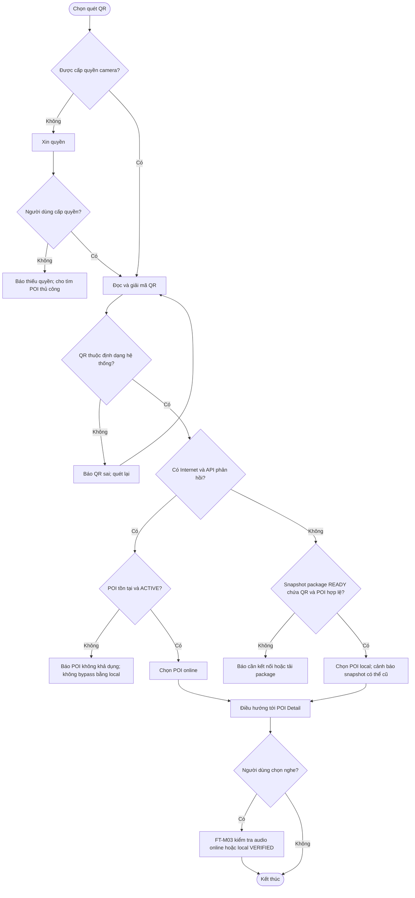

# UC-MOBILE-04 — Quét QR Code để truy cập điểm tham quan

| Use case number: | UC-MOBILE-04 |  |
| :---- | :---- | :---- |
| **Use case name:** | Quét QR Code để truy cập điểm tham quan |  |
| **Actor(s):** | Tourist (khách du lịch), Mobile Application |  |
| **Maturity:** | Specification / Target behavior — chức năng được đặc tả theo PRD và database design; chưa xác nhận toàn bộ luồng mobile đã triển khai. |  |
| **Summary:** | Định danh POI bằng QR Code và mở nhanh thông tin/thuyết minh, không phụ thuộc GPS; QR phải tham chiếu POI hợp lệ. **Traceability:** Epic: EP-M02 — Narration Playback and QR Access; Feature / Requirement: FT-M04 / FR-M04; User Story: US-M09; Priority: P0 |  |
| **Basic Course of Events:** | **Actor action** | **System response** |
|  | 1\. Du khách chọn “Quét QR”. |  |
|  |  | 2\. Ứng dụng kiểm tra và yêu cầu quyền camera khi cần. **E1** |
|  |  | 3\. Camera đọc QR; ứng dụng phân tích giá trị và kiểm tra cấu trúc/định dạng cho phép. **E2, E6** |
|  |  | 4\. Ứng dụng đối chiếu QR với POI: online qua nguồn công khai hoặc offline qua dữ liệu POI đã có. **A1, A2, E3, E4** |
|  |  | 5\. Kiểm tra trạng thái POI được phép truy cập tại nguồn đang dùng. **E5** |
|  |  | 6\. Điều hướng đến màn hình chi tiết POI; người dùng có thể chủ động chọn phát narration. |
|  |  | 7\. Khi yêu cầu phát, FT-M03 chọn audio/ngôn ngữ và xử lý offline/online theo quy tắc tương ứng. **A3, E4** |
| **Alternative Paths:** | **A1 — QR hợp lệ khi online:** Tra POI ACTIVE từ backend, mở detail; yêu cầu nghe chuyển tới FT-M03.  **A2 — QR hợp lệ khi offline, local package READY có POI:** Tra `poi_qr_code` trong snapshot local, mở detail; nghe nếu asset VERIFIED cùng ngôn ngữ có sẵn.  **A3 — Không cấp GPS:** QR vẫn hoạt động vì không yêu cầu GPS. |  |
| **Exception Paths:** | **E1 — Không cấp camera hoặc camera không sẵn sàng:** Thông báo quyền/thiết bị, cung cấp cách tìm POI thủ công.  **E2 — QR sai định dạng, URL lạ hoặc không map POI:** Không điều hướng; báo QR không hợp lệ và cho quét lại.  **E3 — Online API timeout/5xx hoặc mất mạng trong tra cứu:** Thử local package READY; nếu POI không có, báo cần kết nối.  **E4 — Offline không có package READY hoặc QR không thuộc snapshot:** Không mở POI/không phát audio; giải thích cần tải dữ liệu khi online.  **E5 — POI INACTIVE hoặc đã bị xóa trên server:** Từ chối điều hướng với dữ liệu online; snapshot offline chỉ biết trạng thái tại lần tải trước.  **E6 — Quét cùng mã nhiều lần liên tiếp:** Chặn xử lý trùng trước khi hoàn thành điều hướng. |  |
| **Extension Points:** | Có thể mở rộng theo các năng lực tích hợp mobile, backend và chính sách vận hành đã ghi trong PRD; không nằm trong phạm vi xác nhận triển khai hiện tại. |  |
| **Triggers:** | Người dùng chọn chức năng quét QR Code. |  |
| **Assumptions:** | Mã QR nhận diện POI theo dữ liệu đã công bố; không phụ thuộc GPS. |  |
| **Preconditions:** | Ứng dụng có màn hình quét và có thể yêu cầu quyền camera; có nguồn tra cứu POI online hoặc snapshot offline đã tải. |  |
| **Post Conditions:** | QR hợp lệ điều hướng đúng `poi_id`; QR không hợp lệ không tạo thao tác phát. |  |
| **Preferences:** | Ưu tiên bảo đảm quyền riêng tư, không khai báo chức năng đã triển khai khi mới ở mức thiết kế; xử lý nguồn dữ liệu/phiên bản đúng PRD và database contract. |  |
| **Author(s):** | MNR Documentation Team |  |
| **Date:** | 09-11-2026 |  |

## Business Rules and Acceptance Criteria

**Phân biệt trạng thái:** Khi backend xác nhận POI INACTIVE, không được fallback sang local chỉ để vượt hạn chế public; fallback local chỉ áp dụng khi không thể xác minh qua backend (offline hoặc lỗi truy vấn), với cảnh báo snapshot có thể cũ.

**BR-01, BR-02:** QR không thay thế quy tắc public POI ACTIVE; Tourist không cần đăng nhập.  **AC-M04-01:** US-M09 quét QR hợp lệ mở đúng chi tiết POI tương ứng.  **AC-M04-02:** QR không hợp lệ, camera bị từ chối, POI không có sẵn đều có thông báo rõ.  **AC-M04-03:** Quy trình QR thực hiện được mà không yêu cầu GPS.  **AC-M04-04:** Khi offline, chỉ truy cập tài nguyên có trong package READY và đã xác minh trước khi phát.

## Activity Diagram

## Traceability, Data and Implementation Notes

- **Nguồn dữ liệu:** `Point_Of_Interests.poi_qr_code` là giá trị duy nhất; `poi_status`; `Local_POIs` nếu dùng ngoại tuyến.
- **Liên kết:** Dependencies / Notes
- FT-M01 cung cấp chi tiết; FT-M03 phát audio; FT-M07 cung cấp snapshot.
- Không suy diễn rằng quét QR tự động phát trong mọi tình huống: theo US-M09, luồng chính điều hướng đến nội dung và người dùng có thể yêu cầu phát.
- Nguồn: PRD.md FR-M04, US-M09, BR-01/02/14; `docs/database-design.md` §2.2.1, §3.
- **Nguồn tham khảo:** PRD.md (§2.3, §3.3–3.4); `docs/database-design.md`; mẫu bố cục `docs/usecase/authentication-session.md`.
