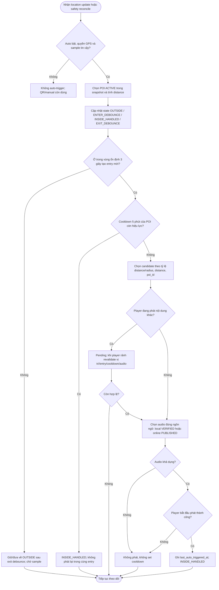

# UC-MOBILE-05 — Phát hiện vị trí và xử lý Geofence

| Use case number: | UC-MOBILE-05 |  |
| :---- | :---- | :---- |
| **Use case name:** | Phát hiện vị trí và xử lý Geofence |  |
| **Actor(s):** | Tourist (khách du lịch), Mobile Application, Location Services của Android/iOS |  |
| **Maturity:** | Specification / Target behavior — chức năng được đặc tả theo PRD và database design; chưa xác nhận toàn bộ luồng mobile đã triển khai. |  |
| **Summary:** | Nhận diện entry/exit của vùng POI và chỉ đề xuất tự phát khi sự kiện hợp lệ, không rung do GPS và không chồng audio. **Traceability:** Epic: EP-M03 — Automatic Geofence Narration; Feature / Requirement: FT-M05 / FR-M07; User Stories: US-M10, US-M11; Priority: P0 |  |
| **Basic Course of Events:** | **Actor action** | **System response** |
|  |  | 1\. Nhận location update/reconcile, xác minh auto setting, quyền và location sample đủ mới. **A1, E1, E3** |
|  |  | 2\. Tính khoảng cách đến POI ACTIVE và so với trigger_radius_meter. |
|  |  | 3\. Qua OUTSIDE/ENTER_DEBOUNCE/INSIDE_HANDLED/EXIT_DEBOUNCE, debounce entry và exit 3 giây. **E2** |
|  |  | 4\. Sau entry hợp lệ, kiểm tra cooldown 5 phút; không phát lại trong cùng entry kể cả khi cooldown kết thúc. **E4, E7** |
|  |  | 5\. POI overlap: sắp theo distance/radius, distance và poi_id; chọn duy nhất một. **A2** |
|  |  | 6\. Nếu player bận, giữ pending candidate và revalidate khi player rảnh. **A3, E6** |
|  |  | 7\. Kiểm tra audio đúng ngôn ngữ: local VERIFIED hoặc server PUBLISHED; không có thì không auto-play. **A4, E5, E6** |
|  |  | 8\. Chỉ ghi cooldown và Listening Event AUTO_LOCATION sau playback start; exit ổn định mới reset OUTSIDE. |
| **Alternative Paths:** | **A1 — Entry mới khi người dùng đã ở trong vùng lúc mở app:** Safety reconcile đọc sample mới, chuyển OUTSIDE → ENTER_DEBOUNCE; chỉ trigger sau đủ 3 giây.  **A2 — Nhiều Geofence cùng đủ điều kiện:** Xếp theo tỷ lệ distance/trigger_radius_meter thấp hơn, distance tuyệt đối thấp hơn, poi_id tăng dần; chọn tối đa một candidate.  **A3 — Đang phát narration khác:** Giữ pending candidate; khi player rảnh kiểm tra lại vị trí, entry, cooldown và audio trước khi phát; không tự cắt ngang.  **A4 — Có Internet nhưng thiếu local audio:** Truy vấn nội dung PUBLISHED/audio online; chỉ ghi cooldown khi phát thực sự thành công. |  |
| **Exception Paths:** | **E1 — GPS không được cấp quyền, bị tắt hoặc sample stale/accuracy kém:** Không auto-trigger; QR/manual vẫn dùng được.  **E2 — GPS dao động tại ranh giới:** Yêu cầu debounce 3 giây cho entry và exit; sự kiện không ổn định không thay state.  **E3 — Miss location callback:** Safety reconcile mỗi 5 giây khi runtime cho phép, đưa mẫu mới qua cùng state machine; không bypass debounce/cooldown.  **E4 — Re-entry trong cooldown 5 phút:** Đánh dấu INSIDE_HANDLED nhưng không phát; cooldown hết khi còn ở trong vùng không gây trigger mới.  **E5 — Mất mạng và không có local VERIFIED audio:** Không phát và không đặt last_auto_triggered_at.  **E6 — Audio load thất bại hoặc pending candidate đã ra khỏi vùng:** Không phát; không ghi cooldown; loại pending không còn hợp lệ.  **E7 — App restart khi cooldown chưa hết:** Đọc Local_POI_Trigger_State để tiếp tục cooldown theo POI. |  |
| **Extension Points:** | Có thể mở rộng theo các năng lực tích hợp mobile, backend và chính sách vận hành đã ghi trong PRD; không nằm trong phạm vi xác nhận triển khai hiện tại. |  |
| **Triggers:** | Ứng dụng nhận mẫu vị trí/entry event khi chế độ tự thuyết minh đang bật. |  |
| **Assumptions:** | Location sample mới/đủ chính xác; cooldown được lưu, debounce/inside-outside chủ yếu runtime và cần revalidate sau restart. |  |
| **Preconditions:** | Người dùng đã bật auto narration; đã cấp quyền vị trí phù hợp; GPS đang bật; có mẫu vị trí đủ tin cậy và metadata POI ACTIVE; có thể truy cập audio hợp lệ. |  |
| **Post Conditions:** | Một entry được xử lý tối đa một lần; chỉ một candidate được chuyển đến FT-M03; cooldown chỉ ghi khi audio thực sự bắt đầu. |  |
| **Preferences:** | Ưu tiên bảo đảm quyền riêng tư, không khai báo chức năng đã triển khai khi mới ở mức thiết kế; xử lý nguồn dữ liệu/phiên bản đúng PRD và database contract. |  |
| **Author(s):** | MNR Documentation Team |  |
| **Date:** | 09-11-2026 |  |

## Business Rules and Acceptance Criteria

Thứ tự chọn POI khi overlap là `(distance / trigger_radius_meter) ASC`, `distance ASC`, `poi_id ASC`; dùng mẫu vị trí tin cậy. Safety reconcile 5 giây không thể cam kết trong OS background bị hạn chế. State được lưu/khôi phục để không phát lại do restart.

**BR-12, BR-13:** Tôn trọng bật/tắt auto và cooldown; **không** áp cooldown AUTO_LOCATION cho mọi yêu cầu manual/QR.  **AC-M05-01:** US-M10 entry đủ điều kiện được xử lý sau debounce 3 giây.  **AC-M05-02:** US-M11 không phát trùng trong cùng entry hoặc trong cooldown 5 phút của cùng POI.  **AC-M05-03:** Safety reconcile 5 giây không bypass debounce/cooldown.  **AC-M05-04:** Khi POI overlap, hệ thống chỉ chọn tối đa một audio.  **AC-M05-05:** Chỉ ghi cooldown sau khi player thực sự bắt đầu; pending candidate được revalidate trước khi phát.

## Activity Diagram

## Traceability, Data and Implementation Notes

- **Dependencies:** FT-M03/06/07/08; sample mới và state machine là bắt buộc.
- **Sources:** `PRD.md` (Feature/Requirement/User Story), `docs/database-design.md` (database contract), template `docs/usecase/authentication-session.md`.
- **Maturity:** Target behavior / đặc tả, không khẳng định tính năng đã chạy trên client và backend.

## Exception Acceptance Scenarios

- **AT-FT01**: GPS dao động dưới 3 giây: không trigger.
- **AT-FT02**: Re-entry trong cooldown: không phát; hết cooldown khi còn trong vùng cũng không phát.
- **AT-FT03**: POI overlap: dùng ratio, distance rồi poi_id, không có priority.
- **AT-FT04**: Pending candidate ra khỏi vùng: revalidate và không phát.
- **AT-FT05**: App restart: khôi phục cooldown local, bỏ sample stale.
