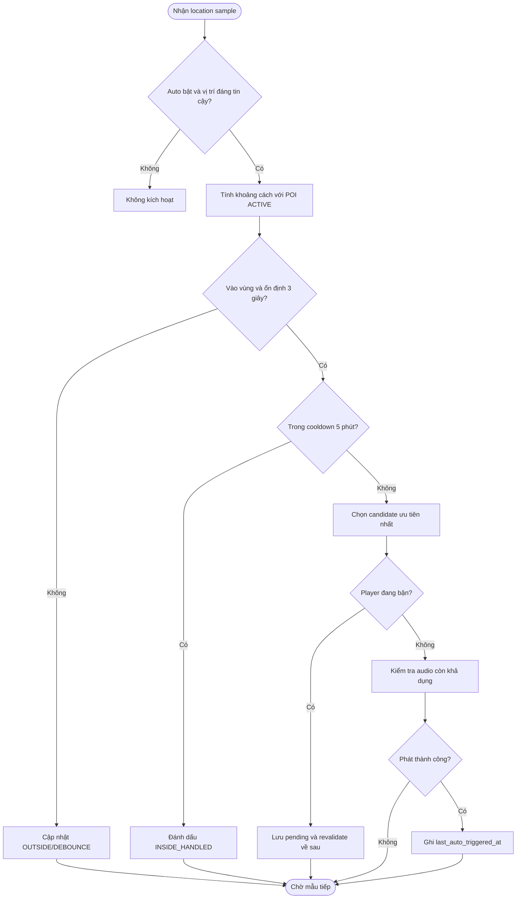

# FT-M05 — Location-based Geofence Detection

## 1. Overview

| Thuộc tính | Giá trị |
| --- | --- |
| Epic | EP-M03 — Automatic Geofence Narration |
| Feature / Requirement | FT-M05 / FR-M07 |
| User Stories | US-M10, US-M11 |
| Actor | Tourist; Mobile Location/Geofence Engine |
| Priority | P0 |

**Mục tiêu:** Nhận diện entry/exit của vùng POI và chỉ đề xuất tự phát khi sự kiện hợp lệ, không rung do GPS và không chồng audio.

## 2. Preconditions / Postconditions

- **Tiền điều kiện:** Người dùng đã bật auto narration; đã cấp quyền vị trí phù hợp; GPS đang bật; có mẫu vị trí đủ tin cậy và metadata POI ACTIVE; có thể truy cập audio hợp lệ.
- **Hậu điều kiện:** Một entry được xử lý tối đa một lần; chỉ một candidate được chuyển đến FT-M03; cooldown chỉ ghi khi audio thực sự bắt đầu.
- **Dữ liệu:** `Point_Of_Interests(latitude, longitude, trigger_radius_meter, poi_status)`, `Local_POI_Trigger_State` và trạng thái player.

## 3. Main Flow

1. Location Engine nhận mẫu tọa độ, kiểm tra độ mới và độ chính xác.
2. Đối với POI có liên quan, tính khoảng cách và so với `trigger_radius_meter`.
3. Xử lý state machine `OUTSIDE → ENTER_DEBOUNCE → INSIDE_HANDLED → EXIT_DEBOUNCE → OUTSIDE`.
4. Khi chuyển từ OUTSIDE vào vùng, bắt đầu **debounce 3 giây**; nếu rời vùng trước khi đủ thời gian, hủy entry.
5. Sau khi ở trong vùng ổn định, kiểm tra **cooldown 5 phút** theo từng POI cho `AUTO_LOCATION`. Nếu đang cooldown, đánh dấu entry đã xử lý nhưng không phát.
6. Nếu nhiều POI cùng đủ điều kiện, chọn lần lượt theo `trigger_priority` cao hơn (nếu metadata hỗ trợ), tỷ lệ khoảng cách/bán kính thấp hơn, khoảng cách tuyệt đối thấp hơn, rồi `poi_id` để phân xử ổn định.
7. Nếu player đang bận, lưu pending candidate và **kiểm tra lại** khi audio hiện tại kết thúc; không tự cắt ngang.
8. Chỉ chuyển yêu cầu phát tới FT-M03 khi điều kiện còn hợp lệ; sau khi bắt đầu phát thành công, cập nhật `last_auto_triggered_at`.
9. Khi exit ổn định đủ debounce, trả POI về OUTSIDE để chờ entry mới.

## 4. Alternative / Exception Flows

| Trường hợp | Xử lý |
| --- | --- |
| GPS nhảy tại biên | Debounce 3 giây cho entry/exit; không kích hoạt theo một mẫu đơn lẻ. |
| Miss callback vị trí | Safety reconcile mỗi **5 giây** đưa mẫu qua cùng state machine, không gọi player trực tiếp. |
| Cooldown hết khi vẫn đứng trong vùng | Không tự phát lại; chỉ xét entry mới sau exit/re-entry. |
| Nhiều POI chồng lấn | Chọn tối đa một; các POI khác tiếp tục theo dõi. |
| Mẫu vị trí stale/không đủ tin cậy | Không trigger; chờ mẫu mới. |
| Không có audio local, thiết bị offline | Không phát và không ghi cooldown. |
| Người dùng tắt auto hoặc thu hồi quyền vị trí | Dừng auto detection; QR/manual vẫn hoạt động. |

## 5. Rules / Acceptance Criteria

- **BR-12, BR-13:** Tôn trọng bật/tắt auto và cooldown; **không** áp cooldown AUTO_LOCATION cho mọi yêu cầu manual/QR.
- **AC-M05-01:** US-M10 entry đủ điều kiện được xử lý sau debounce 3 giây.
- **AC-M05-02:** US-M11 không phát trùng trong cùng entry hoặc trong cooldown 5 phút của cùng POI.
- **AC-M05-03:** Safety reconcile 5 giây không bypass debounce/cooldown.
- **AC-M05-04:** Khi POI overlap, hệ thống chỉ chọn tối đa một audio.
- **AC-M05-05:** Chỉ ghi cooldown sau khi player thực sự bắt đầu; pending candidate được revalidate trước khi phát.

## 6. Activity Diagram

## 7. Dependencies / Notes

- Phụ thuộc FT-M06 cho location background, FT-M08 để bật/tắt auto, FT-M03 cho phát và FT-M07 cho metadata local.
- **Điểm cần đối chiếu hợp đồng dữ liệu:** `trigger_priority` được nêu trong quy tắc phân xử tại `docs/database-design.md` §4.2.7 nhưng không xuất hiện trong danh sách field của `Point_Of_Interests` §2.2.1; cần xác nhận nguồn metadata trước khi triển khai. Không tự giả định đã có cột này.
- Nguồn: PRD.md FR-M07, US-M10–11, BR-12–13; `docs/database-design.md` §4.2.
