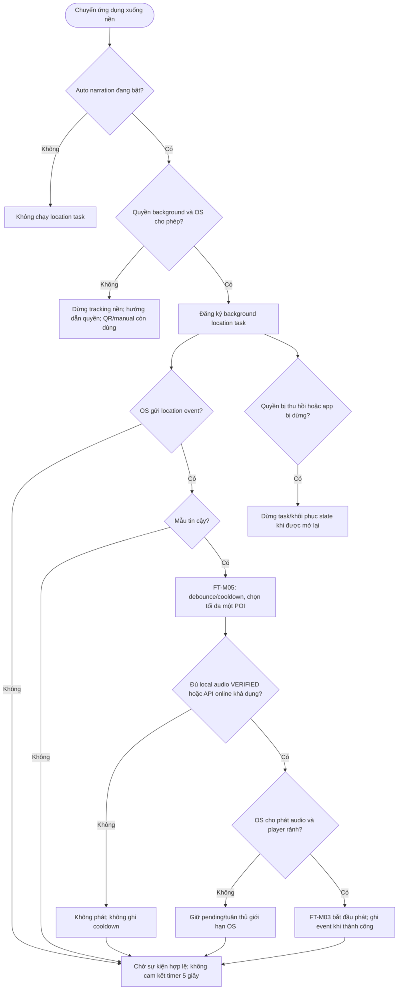

# UC-MOBILE-06 — Theo dõi vị trí và thuyết minh ở chế độ nền

| Use case number: | UC-MOBILE-06 |  |
| :---- | :---- | :---- |
| **Use case name:** | Theo dõi vị trí và thuyết minh ở chế độ nền |  |
| **Actor(s):** | Tourist (khách du lịch), Mobile Application, Location Services của Android/iOS |  |
| **Maturity:** | Specification / Target behavior — chức năng được đặc tả theo PRD và database design; chưa xác nhận toàn bộ luồng mobile đã triển khai. |  |
| **Summary:** | Tiếp tục nhận diện sự kiện Geofence khi ứng dụng ở nền **trong phạm vi hệ điều hành cho phép**, đồng thời tôn trọng quyền vị trí, tùy chọn người dùng và trạng thái nguồn lực thiết bị. **Traceability:** Epic: EP-M03 — Automatic Geofence Narration; Feature / Requirement: FT-M06 / FR-M08; User Story: US-M12; Priority: P0 |  |
| **Basic Course of Events:** | **Actor action** | **System response** |
|  | 1\. Du khách bật chế độ tự động thuyết minh trong FT-M08. |  |
|  |  | 2\. Ứng dụng kiểm tra quyền foreground/background và trạng thái Location Services theo nền tảng. **A1, E2** |
|  |  | 3\. Ứng dụng đăng ký dịch vụ/location task phù hợp chính sách hệ điều hành và phạm vi phiên tham quan khi có quy định đó. **E1** |
|  |  | 4\. Khi app chuyển background, nền tảng gửi location update hoặc transition event (nếu được cho phép). **A2, E1** |
|  |  | 5\. Service chuẩn hóa/kiểm tra độ mới, độ chính xác của mẫu; chuyển sang FT-M05. **E3** |
|  |  | 6\. FT-M05 áp dụng debounce 3 giây, reconcile 5 giây khi khả thi, cooldown 5 phút và quy tắc chọn một candidate. **A3, E6** |
|  |  | 7\. Nếu có yêu cầu phát, FT-M03 xử lý theo quyền audio/background playback và trạng thái player; không giả định mọi nền tảng cho phép autoplay khi bị khóa hoặc app bị kill. **E4, E5** |
|  |  | 8\. Khi người dùng tắt auto hoặc thu hồi quyền, hủy đăng ký/dừng dịch vụ tương ứng và tiếp tục hỗ trợ QR/manual. **E2** |
| **Alternative Paths:** | **A1 — Ứng dụng còn foreground hoặc chỉ có quyền foreground:** Tiếp tục Geofence ở foreground; không khởi động tracking nền trái quyền.  **A2 — Background event đến trong khi offline:** FT-M05 xử lý theo snapshot POI local và phát chỉ khi audio VERIFIED; không bắt buộc mạng để nhận event.  **A3 — Có event lúc narration đang phát:** Không phát chồng; áp dụng pending/revalidate của FT-M05. |  |
| **Exception Paths:** | **E1 — Hệ điều hành đình chỉ task, app kill hoặc hạn chế battery saver:** Không cam kết callback hay vòng lặp 5 giây; khi app trở lại, phục hồi state và xác minh location sample mới.  **E2 — Người dùng thu hồi background permission, tắt GPS hoặc tắt auto:** Dừng subscription/trigger tự động; giữ QR/manual hoạt động.  **E3 — Sample quá cũ hoặc sai số lớn:** Không chuyển thẳng tới player; bỏ sample hoặc chờ location cập nhật.  **E4 — OS không cho autoplay khi nền/khóa màn hình:** Không vượt giới hạn nền tảng; thực hiện hành vi phát/thông báo được OS cho phép, tránh tạo event phát thành công giả.  **E5 — Offline không có snapshot ACTIVE hoặc audio VERIFIED:** Không phát; có thể thông báo tải nội dung khi kết nối trở lại.  **E6 — App restart với cooldown/entry state còn hiệu lực:** Khôi phục `Local_POI_Trigger_State`, không kích hoạt trùng khi chưa có entry mới. |  |
| **Extension Points:** | Có thể mở rộng theo các năng lực tích hợp mobile, backend và chính sách vận hành đã ghi trong PRD; không nằm trong phạm vi xác nhận triển khai hiện tại. |  |
| **Triggers:** | Ứng dụng chuyển sang background và hệ điều hành gửi sự kiện vị trí hợp lệ. |  |
| **Assumptions:** | OS có thể đình chỉ tác vụ nền; không cam kết callback chính xác theo thời gian thực. |  |
| **Preconditions:** | Auto narration được bật; ứng dụng đã giải thích và nhận quyền vị trí cần thiết; hệ điều hành cho phép cơ chế theo dõi nền tương ứng; có POI metadata. |  |
| **Post Conditions:** | Sự kiện vị trí được chuyển qua cùng Geofence Engine như foreground; không tạo audio trùng, không tiếp tục theo dõi khi không được phép. |  |
| **Preferences:** | Ưu tiên bảo đảm quyền riêng tư, không khai báo chức năng đã triển khai khi mới ở mức thiết kế; xử lý nguồn dữ liệu/phiên bản đúng PRD và database contract. |  |
| **Author(s):** | MNR Documentation Team |  |
| **Date:** | 09-11-2026 |  |

## Business Rules and Acceptance Criteria

**Lưu ý nền tảng:** Safety reconcile 5 giây chỉ là quy tắc logic theo database design; Android/iOS không bảo đảm đánh thức dịch vụ chạy nền đúng nhịp. Offline cần snapshot POI và audio đã xác minh, không chỉ cần GPS.

**BR-12, BR-13:** Tính năng phụ thuộc auto setting, quyền location và cooldown.  **AC-M06-01:** US-M12 khi được cấp quyền nền và OS hỗ trợ, location event hợp lệ được xử lý qua FT-M05.  **AC-M06-02:** Không cấp hoặc thu hồi quyền nền thì ứng dụng không tiếp tục truy cập vị trí trái phép.  **AC-M06-03:** Không có GPS/background service vẫn cho phép quét QR và phát thủ công.  **AC-M06-04:** Sự kiện nền không được bỏ qua chính sách một audio/cooldown/độ tin cậy của mẫu.

## Activity Diagram

## Traceability, Data and Implementation Notes

- **Nguồn dữ liệu:** Tham chiếu PRD và database design.
- **Liên kết:** Dependencies / Notes
- Tích hợp FT-M05, FT-M03, FT-M08, FT-M07.
- Thông số **5 giây reconcile** là quy tắc thiết kế logic, không phải cam kết OS sẽ đánh thức ứng dụng chính xác mỗi 5 giây trong background.
- Cần kiểm thử độc lập trên Android/iOS và trạng thái foreground/background/terminated trước nghiệm thu.
- Nguồn: PRD.md FR-M08, US-M12, BR-12–13; `docs/database-design.md` §4.2.
- **Nguồn tham khảo:** PRD.md (§2.3, §3.3–3.4); `docs/database-design.md`; mẫu bố cục `docs/usecase/authentication-session.md`.
