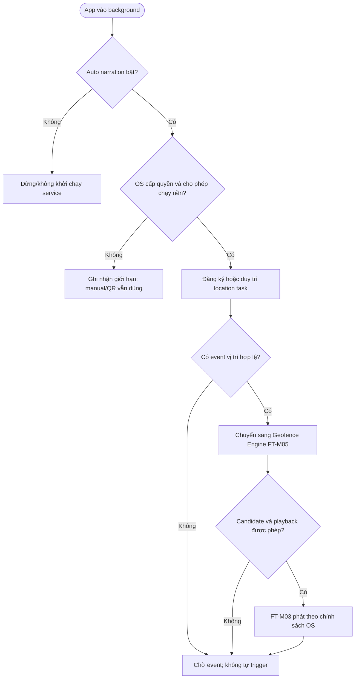

# FT-M06 — Background Location and Narration Service

## 1. Overview

| Thuộc tính | Giá trị |
| --- | --- |
| Epic | EP-M03 — Automatic Geofence Narration |
| Feature / Requirement | FT-M06 / FR-M08 |
| User Story | US-M12 |
| Actor | Tourist; Android/iOS Location Services; Mobile Background Service |
| Priority | P0 |

**Mục tiêu:** Tiếp tục nhận diện sự kiện Geofence khi ứng dụng ở nền **trong phạm vi hệ điều hành cho phép**, đồng thời tôn trọng quyền vị trí, tùy chọn người dùng và trạng thái nguồn lực thiết bị.

## 2. Preconditions / Postconditions

- **Tiền điều kiện:** Auto narration được bật; ứng dụng đã giải thích và nhận quyền vị trí cần thiết; hệ điều hành cho phép cơ chế theo dõi nền tương ứng; có POI metadata.
- **Hậu điều kiện:** Sự kiện vị trí được chuyển qua cùng Geofence Engine như foreground; không tạo audio trùng, không tiếp tục theo dõi khi không được phép.

## 3. Main Flow

1. Du khách bật chế độ tự động thuyết minh trong FT-M08.
2. Ứng dụng kiểm tra quyền foreground/background và trạng thái Location Services theo nền tảng.
3. Ứng dụng đăng ký dịch vụ/location task phù hợp chính sách hệ điều hành và phạm vi phiên tham quan khi có quy định đó.
4. Khi app chuyển background, nền tảng gửi location update hoặc transition event (nếu được cho phép).
5. Service chuẩn hóa/kiểm tra độ mới, độ chính xác của mẫu; chuyển sang FT-M05.
6. FT-M05 áp dụng debounce 3 giây, reconcile 5 giây khi khả thi, cooldown 5 phút và quy tắc chọn một candidate.
7. Nếu có yêu cầu phát, FT-M03 xử lý theo quyền audio/background playback và trạng thái player; không giả định mọi nền tảng cho phép autoplay khi bị khóa hoặc app bị kill.
8. Khi người dùng tắt auto hoặc thu hồi quyền, hủy đăng ký/dừng dịch vụ tương ứng và tiếp tục hỗ trợ QR/manual.

## 4. Alternative / Exception Flows

| Trường hợp | Xử lý |
| --- | --- |
| Không có background permission | Giải thích giới hạn; cho phép sử dụng foreground, QR và manual. |
| App bị hệ điều hành đình chỉ/kill | Không cam kết nhận sự kiện liên tục; khôi phục state khi ứng dụng chạy lại nếu dữ liệu còn hợp lệ. |
| Battery saver/hạn chế nền | Thực thi best effort theo OS; không bypass quyền hoặc chính sách năng lượng. |
| Thiết bị mất GPS/accuracy kém | Không kích hoạt dựa trên mẫu stale. |
| Quyền bị thu hồi trong nền | Dừng xử lý tự động; cập nhật trạng thái UI lần tiếp theo mở app. |
| Có narration đang phát | Không mở một phiên phát khác; sử dụng cơ chế pending/revalidate của FT-M05. |

## 5. Rules / Acceptance Criteria

- **BR-12, BR-13:** Tính năng phụ thuộc auto setting, quyền location và cooldown.
- **AC-M06-01:** US-M12 khi được cấp quyền nền và OS hỗ trợ, location event hợp lệ được xử lý qua FT-M05.
- **AC-M06-02:** Không cấp hoặc thu hồi quyền nền thì ứng dụng không tiếp tục truy cập vị trí trái phép.
- **AC-M06-03:** Không có GPS/background service vẫn cho phép quét QR và phát thủ công.
- **AC-M06-04:** Sự kiện nền không được bỏ qua chính sách một audio/cooldown/độ tin cậy của mẫu.

## 6. Activity Diagram

## 7. Dependencies / Notes

- Tích hợp FT-M05, FT-M03, FT-M08, FT-M07.
- Thông số **5 giây reconcile** là quy tắc thiết kế logic, không phải cam kết OS sẽ đánh thức ứng dụng chính xác mỗi 5 giây trong background.
- Cần kiểm thử độc lập trên Android/iOS và trạng thái foreground/background/terminated trước nghiệm thu.
- Nguồn: PRD.md FR-M08, US-M12, BR-12–13; `docs/database-design.md` §4.2.
