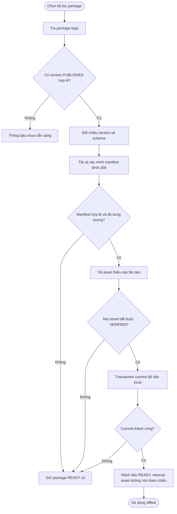

# UC-MOBILE-07 — Tải, cập nhật và sử dụng nội dung ngoại tuyến

| Use case number: | UC-MOBILE-07 |  |
| :---- | :---- | :---- |
| **Use case name:** | Tải, cập nhật và sử dụng nội dung ngoại tuyến |  |
| **Actor(s):** | Tourist (khách du lịch), Mobile Application |  |
| **Maturity:** | Specification / Target behavior — chức năng được đặc tả theo PRD và database design; chưa xác nhận toàn bộ luồng mobile đã triển khai. |  |
| **Summary:** | Chọn/tải gói thuyết minh theo `region + language + category?`, xác minh đầy đủ trước khi dùng offline và quản lý lưu trữ mà không làm hỏng package READY cũ. **Traceability:** Epic: EP-M04 — Offline Content and Preferences; Feature / Requirement: FT-M07 / FR-M05; User Stories: US-M13, US-M14, US-M15; Priority: P0 |  |
| **Basic Course of Events:** | **Actor action** | **System response** |
|  | 1\. Du khách chọn khu vực, ngôn ngữ và bộ lọc danh mục POI tùy chọn. |  |
|  |  | 2\. Mobile xây dựng yêu cầu package logic theo `package_key` canonical và gửi tới backend. |
|  |  | 3\. Backend tra hoặc tạo package logic; chỉ công bố version **PUBLISHED** có manifest/asset hợp lệ, không coi `BUILDING` là sẵn sàng. |
|  |  | 4\. Mobile so sánh `package_version`, `schema_version` và checksum manifest với phiên bản local. |
|  |  | 5\. Mobile tải manifest, xác minh checksum, kiểm tra schema; xác định asset nào đã tồn tại theo checksum. |
|  |  | 6\. Mobile kiểm tra dung lượng, lưu download job, tải những asset còn thiếu vào file tạm `.part`, kiểm tra kích thước và SHA-256. |
|  |  | 7\. Chỉ khi **toàn bộ** asset bắt buộc đã VERIFIED, mobile thực hiện transaction upsert POI/content, cập nhật membership, version/checksum/status `READY`. |
|  |  | 8\. Sau commit thành công mới cleanup asset cũ không còn được package nào tham chiếu. |
|  | 9\. Du khách sử dụng content/audio local khi offline; xem dung lượng và có thể quản lý gói đã tải. |  |
| **Alternative Paths:** | **A1 — Package trên server BUILDING/FAILED chưa có version published:** Thông báo chưa sẵn sàng; không tải như gói hoàn chỉnh.  **A2 — Hai package dùng cùng asset:** Tái sử dụng theo checksum; chỉ xóa asset khi không package nào tham chiếu. |  |
| **Exception Paths:** | **E1 — Package trên server BUILDING/FAILED chưa có version published:** Thông báo chưa sẵn sàng; không tải như gói hoàn chỉnh.  **E2 — Manifest checksum sai/schema không tương thích:** Từ chối phiên bản; giữ local READY cũ.  **E3 — Thiếu dung lượng:** Dừng trước download/commit; cho phép giải phóng dung lượng.  **E4 — Mất mạng/app bị kill/timeout:** Lưu download job; resume/retry phù hợp; không commit bản tải dở.  **E5 — Asset thiếu, SHA-256 sai:** Không đánh dấu VERIFIED; xóa file tạm và tải lại có giới hạn.  **E6 — Transaction local thất bại:** Rollback toàn bộ chuyển version; package cũ vẫn READY.  **E7 — Server publish v3 khi client tải v2:** Cho hoàn tất manifest bất biến v2; kiểm tra version mới ở lần tiếp theo.  **E8 — Hai package dùng cùng asset:** Tái sử dụng theo checksum; chỉ xóa asset khi không package nào tham chiếu. |  |
| **Extension Points:** | Có thể mở rộng theo các năng lực tích hợp mobile, backend và chính sách vận hành đã ghi trong PRD; không nằm trong phạm vi xác nhận triển khai hiện tại. |  |
| **Triggers:** | Người dùng yêu cầu tải/cập nhật/quản lý gói nội dung offline. |  |
| **Assumptions:** | Backend phải xuất bản manifest và tài nguyên hợp lệ; metadata DB không đồng nghĩa asset đã upload xong. |  |
| **Preconditions:** | Có kết nối để tải; backend có package/manifest phù hợp; thiết bị hỗ trợ schema và đủ dung lượng. |  |
| **Post Conditions:** | Package version mới ở trạng thái local `READY`, asset bắt buộc `VERIFIED`, có thể phát không cần mạng. Không kích hoạt package mới; package READY trước đó vẫn dùng được. |  |
| **Preferences:** | Ưu tiên bảo đảm quyền riêng tư, không khai báo chức năng đã triển khai khi mới ở mức thiết kế; xử lý nguồn dữ liệu/phiên bản đúng PRD và database contract. |  |
| **Author(s):** | MNR Documentation Team |  |
| **Date:** | 09-11-2026 |  |

## Business Rules and Acceptance Criteria

**BR-06, BR-07, BR-08, BR-14:** Package offline một ngôn ngữ xác định; chỉ PUBLISHED được phân phối; BUILDING không sẵn sàng; toàn vẹn bắt buộc trước kích hoạt.  **AC-M07-01:** US-M13 chọn region/language/category? truy xuất đúng package logic.  **AC-M07-02:** US-M14 khi mất mạng vẫn truy cập được POI/audio từ package READY và asset VERIFIED.  **AC-M07-03:** US-M15 hiển thị dung lượng và cho phép quản lý gói mà không xóa nhầm asset dùng chung.  **AC-M07-04:** Checksum sai, schema sai, thiếu bộ nhớ, transaction thất bại không làm mất bản READY trước đó.  **AC-M07-05:** Không áp dụng online English fallback tự động khi chỉ có package offline theo ngôn ngữ khác.

## Activity Diagram

Activity Diagram

## Traceability, Data and Implementation Notes

- **Nguồn dữ liệu:** `Offline_Packages`, `Offline_Package_Items`, `Point_Of_Interests`, `Poi_Contents`, `Content_Audios`. `Local_Offline_Packages`, `Local_POIs`, `Local_Poi_Contents`, `Local_Assets`, `Local_Package_Items`, `Local_Download_Jobs`.
- **Liên kết:** Dependencies / Notes
- FT-M01/02/03/04/05 có thể dùng snapshot local; FT-M08 chọn ngôn ngữ tải.
- Server metadata package/manifest và cơ chế tải vật lý là hai giai đoạn; không đồng nhất “có DB row” với “đã có bundle tải hoàn chỉnh”.
- Nguồn: PRD.md FR-M05, US-M13–15, BR-06–08/14; `docs/database-design.md` §2.3, §3, §4.1.
- **Nguồn tham khảo:** PRD.md (§2.3, §3.3–3.4); `docs/database-design.md`; mẫu bố cục `docs/usecase/authentication-session.md`.
