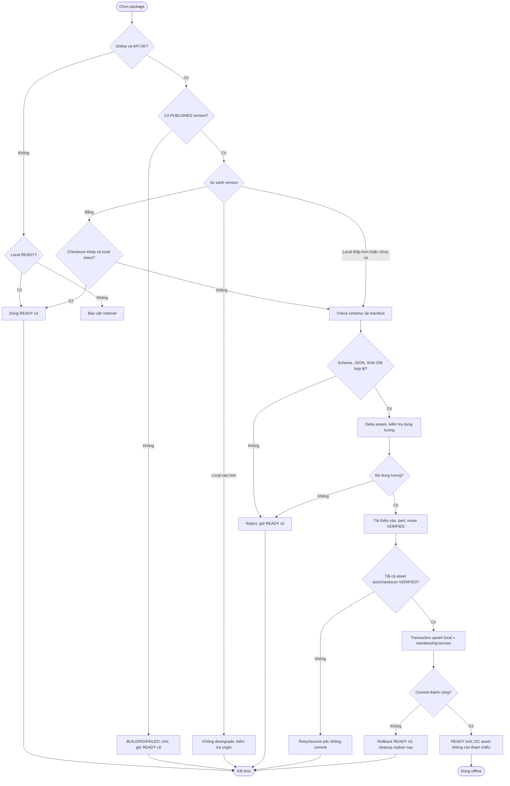

# UC-MOBILE-07 — Tải, cập nhật và sử dụng nội dung ngoại tuyến

| Use case number: | UC-MOBILE-07 |  |
| :---- | :---- | :---- |
| **Use case name:** | Tải, cập nhật và sử dụng nội dung ngoại tuyến |  |
| **Actor(s):** | Tourist (khách du lịch), Mobile Application |  |
| **Maturity:** | Specification / Target behavior — chức năng được đặc tả theo PRD và database design; chưa xác nhận toàn bộ luồng mobile đã triển khai. |  |
| **Summary:** | Chọn/tải gói thuyết minh theo `region + language + category?`, xác minh đầy đủ trước khi dùng offline và quản lý lưu trữ mà không làm hỏng package READY cũ. **Traceability:** Epic: EP-M04 — Offline Content and Preferences; Feature / Requirement: FT-M07 / FR-M05; User Stories: US-M13, US-M14, US-M15; Priority: P0 |  |
| **Basic Course of Events:** | **Actor action** | **System response** |
|  | 1\. Du khách chọn region, language và category tùy chọn. |  |
|  |  | 2\. Kiểm tra mạng; nếu offline chỉ dùng READY cũ hoặc báo cần Internet. **A1, E1** |
|  |  | 3\. Backend tra/tạo package_key; BUILDING/FAILED không được coi là PUBLISHED. **A2, E10** |
|  |  | 4\. So sánh version + manifest checksum local/server; bằng nhau không tải lại nếu READY còn hợp lệ; local cao hơn server không downgrade ngay. **A5** |
|  |  | 5\. Kiểm tra schema; tải và verify manifest, JSON, SHA-256. **E2, E3** |
|  |  | 6\. Tính delta, kiểm tra storage; tái sử dụng VERIFIED và tải thiếu vào .part; retry/resume có giới hạn. **A3, A4, E4, E5, E6, E7, E9** |
|  |  | 7\. Chỉ sau khi toàn bộ asset VERIFIED mới commit transaction local; thất bại rollback giữ READY cũ. **E8** |
|  |  | 8\. GC chỉ xóa file không còn tham chiếu sau commit thành công. **E9** |
|  | 9\. Du khách sử dụng hoặc quản lý package READY. |  |
| **Alternative Paths:** | **A1 — Có local package READY và không có Internet:** Tiếp tục sử dụng phiên bản đã commit; không phát sinh tải mới.  **A2 — Server đang BUILDING/FAILED phiên bản mới nhưng có bản PUBLISHED cũ:** Tiếp tục phân phối version PUBLISHED cũ; mobile giữ local READY trước khi có bản mới.  **A3 — Tệp checksum đã có trên máy:** Tái sử dụng `Local_Assets` VERIFIED thay vì tải lại, có lock khi hai package cần cùng asset.  **A4 — Máy tắt ứng dụng hoặc mất mạng trong download:** Giữ `Local_Download_Jobs` và file `.part`; resume/retry khi điều kiện phục hồi, không commit sớm.  **A5 — Server phát hành v3 trong khi thiết bị đang tải manifest v2 bất biến:** Cho phép hoàn tất v2 rồi kiểm tra phiên bản ở lần cập nhật tiếp theo. |  |
| **Exception Paths:** | **E1 — Không có mạng khi yêu cầu gói mới và chưa có READY:** Thông báo cần Internet, không đánh dấu package READY giả.  **E2 — Manifest URL lỗi, hết hạn HTTP 401/403:** Lấy lại package metadata/URL mới khi có mạng; retry có giới hạn.  **E3 — Manifest sai SHA-256, JSON lỗi hoặc schema_version chưa hỗ trợ:** Reject toàn bộ bản mới, yêu cầu cập nhật ứng dụng nếu schema không hỗ trợ, giữ READY cũ.  **E4 — HTTP 404/410 của asset:** Làm mới manifest/metadata vì có thể stale; không commit bản tải dở.  **E5 — HTTP 5xx/timeout/mất mạng trong tải:** Retry có giới hạn/backoff, giữ job và `.part` hoặc restart download khi thích hợp; package cũ không ảnh hưởng.  **E6 — File tải sai size/SHA-256 hoặc local file thiếu:** Không VERIFIED; xóa file `.part` hỏng và tải lại; file local bị mất phải xác minh lại khi dùng.  **E7 — Không đủ dung lượng hoặc người dùng hủy:** Dừng/PAUSED job; không làm mất package READY đang hoạt động.  **E8 — Transaction commit SQLite thất bại:** Rollback toàn bộ upsert/membership/version; giữ bản READY cũ, dọn orphan asset sau.  **E9 — Hai package tham chiếu cùng asset:** Không xóa physical asset khi còn `Local_Package_Items` tham chiếu; lock theo checksum để tránh tải trùng.  **E10 — Backend rebuild/publish thất bại:** Không phân phối version chưa xác minh; bản PUBLISHED cũ tiếp tục khả dụng. |  |
| **Extension Points:** | Có thể mở rộng theo các năng lực tích hợp mobile, backend và chính sách vận hành đã ghi trong PRD; không nằm trong phạm vi xác nhận triển khai hiện tại. |  |
| **Triggers:** | Người dùng yêu cầu tải/cập nhật/quản lý gói nội dung offline. |  |
| **Assumptions:** | Backend phải xuất bản manifest và tài nguyên hợp lệ; metadata DB không đồng nghĩa asset đã upload xong. |  |
| **Preconditions:** | Có kết nối để tải; backend có package/manifest phù hợp; thiết bị hỗ trợ schema và đủ dung lượng. |  |
| **Post Conditions:** | Thành công: version mới READY, asset VERIFIED, transaction commit xong. Thất bại: giữ nguyên READY trước đó; không kích hoạt dữ liệu tải dở. |  |
| **Preferences:** | Ưu tiên bảo đảm quyền riêng tư, không khai báo chức năng đã triển khai khi mới ở mức thiết kế; xử lý nguồn dữ liệu/phiên bản đúng PRD và database contract. |  |
| **Author(s):** | MNR Documentation Team |  |
| **Date:** | 09-11-2026 |  |

## Version Comparison and Recovery

| Local vs Server | Hành vi |
| --- | --- |
| Chưa có local READY | Tải version PUBLISHED; verify trước commit. |
| Cùng version, manifest checksum trùng | Không tải lại nếu integrity của READY vẫn hợp lệ. |
| Local version thấp hơn | Incremental update: chỉ tải asset thiếu/sai checksum. |
| Local version cao hơn | Không downgrade tự động; kiểm tra metadata từ origin. |
| Schema không hỗ trợ | Reject version mới; giữ READY cũ. |
| Bản mới BUILDING/FAILED nhưng còn PUBLISHED cũ | Tiếp tục phục vụ version PUBLISHED cũ. |

**Postconditions tách biệt:** Thành công commit toàn bộ dữ liệu READY; lỗi không làm thay đổi phiên bản READY trước.

## Business Rules and Acceptance Criteria

**Nguyên tắc atomic:** Không ghi đè READY cũ khi download, validate hoặc transaction chưa hoàn tất. Manifest đã publish là bất biến theo version; asset chia sẻ được lưu theo checksum. Gói offline chỉ gồm ngôn ngữ đã chọn, không tự bổ sung English fallback.

**BR-06, BR-07, BR-08, BR-14:** Package offline một ngôn ngữ xác định; chỉ PUBLISHED được phân phối; BUILDING không sẵn sàng; toàn vẹn bắt buộc trước kích hoạt.  **AC-M07-01:** US-M13 chọn region/language/category? truy xuất đúng package logic.  **AC-M07-02:** US-M14 khi mất mạng vẫn truy cập được POI/audio từ package READY và asset VERIFIED.  **AC-M07-03:** US-M15 hiển thị dung lượng và cho phép quản lý gói mà không xóa nhầm asset dùng chung.  **AC-M07-04:** Checksum sai, schema sai, thiếu bộ nhớ, transaction thất bại không làm mất bản READY trước đó.  **AC-M07-05:** Không áp dụng online English fallback tự động khi chỉ có package offline theo ngôn ngữ khác.

## Activity Diagram

## Traceability, Data and Implementation Notes

- **Dependencies:** FT-M01–FT-M08 dùng nội dung offline; manifest và asset phải xác minh.
- **Sources:** `PRD.md` (Feature/Requirement/User Story), `docs/database-design.md` (database contract), template `docs/usecase/authentication-session.md`.
- **Maturity:** Target behavior / đặc tả, không khẳng định tính năng đã chạy trên client và backend.

## Exception Acceptance Scenarios

- **AT-FT01**: Local READY cùng version/checksum: không tải lại nếu còn toàn vẹn.
- **AT-FT02**: Local cũ hơn server: incremental update theo checksum.
- **AT-FT03**: Local mới hơn server: không downgrade; kiểm tra metadata origin.
- **AT-FT04**: Manifest sai schema/JSON/checksum: reject, giữ READY trước.
- **AT-FT05**: Mất mạng giữa download/asset 404/410/URL 401/403: không commit.
- **AT-FT06**: Commit SQLite thất bại: rollback; cleanup orphan sau.
- **AT-FT07**: Asset chung giữa hai packages: không xóa khi vẫn tham chiếu.
