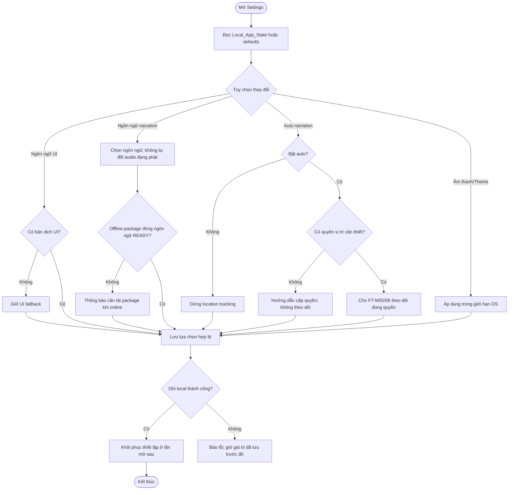

# UC-MOBILE-08 — Tùy chỉnh trải nghiệm người dùng

| Use case number: | UC-MOBILE-08 |  |
| :---- | :---- | :---- |
| **Use case name:** | Tùy chỉnh trải nghiệm người dùng |  |
| **Actor(s):** | Tourist (khách du lịch), Mobile Application |  |
| **Maturity:** | Specification / Target behavior — chức năng được đặc tả theo PRD và database design; chưa xác nhận toàn bộ luồng mobile đã triển khai. |  |
| **Summary:** | Cho phép người dùng tự chọn ngôn ngữ giao diện/nghe, bật tắt tự phát theo vị trí, cấu hình âm lượng và giao diện sáng/tối; duy trì lựa chọn qua các lần sử dụng không cần tài khoản. **Traceability:** Epic: EP-M04 — Offline Content and Preferences; Feature / Requirement: FT-M08 / FR-M06; User Stories: US-M16, US-M17, US-M18; Priority: P0 |  |
| **Basic Course of Events:** | **Actor action** | **System response** |
|  | 1\. Du khách mở Settings. |  |
|  |  | 2\. Đọc Local_App_State hoặc defaults; vẫn dùng offline. **A1, E3** |
|  | 3\. Du khách chọn ngôn ngữ UI hoặc narration. |  |
|  |  | 4\. Thay UI khi có locale; ngôn ngữ narration offline cần package phù hợp; không đổi audio đang phát. **A2, E1, E4** |
|  | 5\. Du khách bật hoặc tắt auto narration. |  |
|  |  | 6\. Bật phải kiểm tra GPS permission; tắt dừng tracking. **A3, E2** |
|  | 7\. Du khách đổi theme hoặc âm lượng. |  |
|  |  | 8\. Chỉ lưu settings nếu local write thành công; tôn trọng giới hạn OS. **E3, E5** |
| **Alternative Paths:** | **A1 — Thay đổi thiết lập khi offline:** Dùng `Local_App_State`, lưu lựa chọn trên thiết bị mà không phụ thuộc API.  **A2 — Chọn ngôn ngữ nghe chưa có audio online:** Giữ preference, khi nghe online fallback tiếng Anh nếu có bản PUBLISHED hợp lệ; offline chỉ theo package đã tải.  **A3 — Tắt auto narration:** Dừng tracking không cần thiết, không tự kích hoạt audio mới; QR/manual vẫn hoạt động. |  |
| **Exception Paths:** | **E1 — Không có ngôn ngữ giao diện tương ứng:** Giữ UI fallback/default đã hỗ trợ; không đồng nhất fallback UI với English audio.  **E2 — Bật auto nhưng GPS/background permission không được cấp:** Không start tracking trái quyền; hướng dẫn cấp quyền và giữ thao tác thủ công.  **E3 — Local storage ghi thất bại hoặc bị reset:** Thông báo không lưu được; khôi phục giá trị đã lưu hoặc default, không nói thay đổi đã được giữ sau restart.  **E4 — Đổi ngôn ngữ nhưng package READY không đúng ngôn ngữ:** Không phát asset sai ngôn ngữ; báo cần tải package mới khi có mạng.  **E5 — Thiết bị hạn chế âm lượng/phát nền:** Tuân thủ OS; không bảo đảm chỉnh âm lượng ngoài quyền ứng dụng. |  |
| **Extension Points:** | Có thể mở rộng theo các năng lực tích hợp mobile, backend và chính sách vận hành đã ghi trong PRD; không nằm trong phạm vi xác nhận triển khai hiện tại. |  |
| **Triggers:** | Người dùng truy cập Settings và thay đổi tùy chọn. |  |
| **Assumptions:** | Thiết lập người dùng được lưu cục bộ, không yêu cầu tài khoản Tourist. |  |
| **Preconditions:** | Ứng dụng đã khởi chạy và có khả năng đọc/ghi local settings. |  |
| **Post Conditions:** | Lựa chọn hợp lệ được lưu bền vững trong `Local_App_State` hoặc kho thiết lập local tương đương; các module liên quan cập nhật hành vi. |  |
| **Preferences:** | Ưu tiên bảo đảm quyền riêng tư, không khai báo chức năng đã triển khai khi mới ở mức thiết kế; xử lý nguồn dữ liệu/phiên bản đúng PRD và database contract. |  |
| **Author(s):** | MNR Documentation Team |  |
| **Date:** | 09-11-2026 |  |

## Business Rules and Acceptance Criteria

**Kết nối:** Thay đổi Settings cơ bản phải hoạt động offline; Internet chỉ cần khi truy vấn danh mục mới hoặc tải package khác ngôn ngữ. Không coi permission của người dùng là đã được cấp chỉ vì chọn bật auto.

**BR-01, BR-05–06, BR-12:** Tourist không cần tài khoản; lựa chọn ngôn ngữ không làm thay đổi quy tắc fallback; auto chỉ chạy khi bật và đủ quyền.  **AC-M08-01:** US-M16 ngôn ngữ giao diện và thuyết minh là hai tùy chọn độc lập.  **AC-M08-02:** US-M17 tắt auto ngăn kích hoạt mới và chấm dứt theo dõi không còn cần thiết.  **AC-M08-03:** US-M18 chỉnh âm thanh, theme và duy trì trạng thái sau restart khi lưu thành công.  **AC-M08-04:** Thay ngôn ngữ không tự chuyển phiên phát đang chạy hoặc package offline hiện tại sang nội dung khác khi chưa xác minh.

## Activity Diagram

## Traceability, Data and Implementation Notes

- **Dependencies:** FT-M03/05/06/07; Local_App_State lưu cục bộ.
- **Sources:** `PRD.md` (Feature/Requirement/User Story), `docs/database-design.md` (database contract), template `docs/usecase/authentication-session.md`.
- **Maturity:** Target behavior / đặc tả, không khẳng định tính năng đã chạy trên client và backend.

## Exception Acceptance Scenarios

- **AT-FT01**: Không mạng vẫn lưu local preferences.
- **AT-FT02**: Ngôn ngữ narration không có READY tương ứng: cảnh báo tải package.
- **AT-FT03**: Bật auto không có permission: không tracking.
- **AT-FT04**: Local write thất bại: không báo đã lưu.
