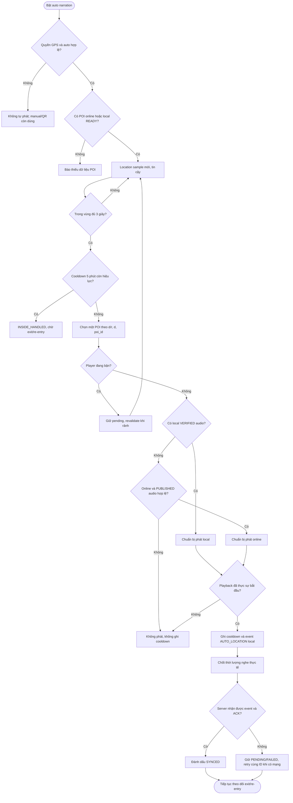

# UC-MOBILE-GEOFENCE-01 — Tự động phát thuyết minh khi đi vào vùng ảnh hưởng của POI

| Use case number: | UC-MOBILE-GEOFENCE-01 |  |
| :---- | :---- | :---- |
| **Use case name:** | Tự động phát thuyết minh khi đi vào vùng ảnh hưởng của POI |  |
| **Actor(s):** | Khách du lịch (Tourist); tác nhân hỗ trợ: dịch vụ định vị của thiết bị, Mobile Application (Geofence Engine, Narration Player, Offline Content Manager, Listening History Synchronizer), hệ thống cung cấp nội dung và nhận lịch sử nghe |  |
| **Maturity:** | Specified — luồng nghiệp vụ mục tiêu; chưa xác nhận toàn bộ hành vi đã triển khai trên Android/iOS hoặc backend |  |
| **Summary:** | Khi du khách bật thuyết minh tự động và đi vào vùng ảnh hưởng của một POI, ứng dụng xác minh vị trí, phát hiện sự kiện vào vùng ổn định, kiểm tra cooldown, giải quyết chồng lấn POI và chọn audio hợp lệ để phát mà không chồng âm thanh. Hệ thống hỗ trợ audio từ package offline đã xác minh hoặc từ server khi có Internet; sau khi audio thực sự bắt đầu, ứng dụng ghi lịch sử nghe trên thiết bị và đồng bộ lên server khi kết nối cho phép. |  |
| **Basic Course of Events:** | **Actor action** | **System response** |
|  | 1\. Du khách bật chức năng **Thuyết minh tự động** và bắt đầu tham quan khu vực có POI. |  |
|  |  | 2\. Ứng dụng kiểm tra chế độ tự động, quyền truy cập vị trí, dịch vụ GPS và phạm vi hoạt động mà hệ điều hành cho phép. **A1, E1, E2, E3** |
|  |  | 3\. Ứng dụng kiểm tra nguồn POI: dùng metadata của package local **READY** nếu có; khi Internet và dịch vụ khả dụng, có thể lấy POI **ACTIVE** từ server. Không dùng package đang tải dở hoặc asset chưa xác minh. **A2, A3, E4, E5, E6** |
|  |  | 4\. Ứng dụng nhận mẫu vị trí mới, xác minh độ mới và độ chính xác, rồi xác định những POI ACTIVE theo nguồn dữ liệu đang dùng. **E7, E8** |
|  |  | 5\. Với mỗi POI có bán kính hợp lệ, ứng dụng tính khoảng cách địa lý `d` từ vị trí thiết bị đến tọa độ POI và đối chiếu với `r = trigger_radius_meter`: `d <= r` là ở trong vùng; `d > r` là ngoài vùng. **E9** |
|  |  | 6\. Geofence Engine cập nhật trạng thái từng POI qua `OUTSIDE`, `ENTER_DEBOUNCE`, `INSIDE_HANDLED` và `EXIT_DEBOUNCE`. Khi chuyển từ ngoài vào trong, hệ thống bắt đầu đo thời gian `inside_since`. **A4, E10** |
|  |  | 7\. Chỉ khi vị trí còn nằm trong vùng ổn định ít nhất **3 giây** (`now - inside_since >= 3s`), hệ thống xác nhận một **entry**; nếu ra ngoài trước mốc này, hủy entry. **E10** |
|  |  | 8\. Khi có khả năng bỏ lỡ location callback, cơ chế **safety reconcile mỗi 5 giây** (khi runtime/OS cho phép) lấy vị trí còn tin cậy và đưa qua đúng state machine ở bước 4–7; không gọi trình phát trực tiếp. **A5, E11** |
|  |  | 9\. Với entry đã xác nhận, ứng dụng đọc `last_auto_triggered_at` của chính POI, kiểm tra cooldown **5 phút**: nếu `now - last_auto_triggered_at < 5 phút` thì bỏ qua phát và đánh dấu entry đã xử lý. **E12, E13** |
|  |  | 10\. Nếu nhiều POI đồng thời đủ điều kiện, hệ thống sắp xếp theo `d/r` tăng dần, sau đó `d` tăng dần và cuối cùng `poi_id` theo thứ tự ổn định; chỉ chọn tối đa một POI. **A6** |
|  |  | 11\. Hệ thống kiểm tra trạng thái player. Nếu có audio khác đang phát, không cắt ngang tự động; ghi nhận POI đang chờ và **kiểm tra lại** vị trí, entry, cooldown, nội dung và audio trước khi có thể phát sau đó. **A7, E14** |
|  |  | 12\. Với POI được chọn, ứng dụng tìm nội dung theo ngôn ngữ đã chọn và xác định nguồn phát: audio local **VERIFIED** trong package **READY**, hoặc nội dung/audio **PUBLISHED** từ server khi online. **A8, E15, E16, E17, E18** |
|  |  | 13\. Trình phát chuẩn bị tài nguyên và yêu cầu phát. Nếu không thể bắt đầu phát thì **không ghi cooldown hoặc sự kiện bắt đầu nghe**. **E18, E19** |
|  |  | 14\. **Chỉ khi audio thực sự bắt đầu**, hệ thống lưu `last_auto_triggered_at = thời điểm bắt đầu` của POI, chuyển entry hiện tại thành `INSIDE_HANDLED`, sinh một ID lịch sử nghe trên thiết bị và ghi sự kiện `AUTO_LOCATION` vào `Local_Listening_Events`. **E20** |
|  |  | 15\. Trong lúc phát, ứng dụng đo **thời lượng phát thực tế**; khi kết thúc hoặc bị dừng, ghi `completed_at` và `duration_sec`. Việc tạm dừng không được cộng vào thời lượng nghe. **A9, E21** |
|  |  | 16\. Hệ thống kiểm tra kết nối và khả năng nhận dữ liệu của server: nếu chưa thể đồng bộ, giữ event local ở trạng thái chờ hoặc lỗi; nếu có thể, gửi các event chưa đồng bộ theo **đúng ID đã sinh**. **A10, E22, E23** |
|  |  | 17\. Chỉ sau khi server xác nhận đã lưu/nhận đúng event, ứng dụng đánh dấu `SYNCED`. Nếu request bị timeout hoặc không được xác nhận, giữ ID cũ và retry theo chính sách; server chống ghi trùng theo ID. **E23, E24** |
|  |  | 18\. Khi thiết bị đi ra ngoài POI, hệ thống xác nhận exit ổn định (debounce 3 giây) rồi đưa trạng thái về `OUTSIDE`; chỉ một lần **exit → re-entry** mới có thể tạo entry mới cho POI đó. **A11, E10, E12** |
| **Alternative Paths:** | **A1 — Chỉ có quyền định vị khi ứng dụng mở:** Tại bước 2, nếu ứng dụng chỉ được cấp quyền foreground, tiếp tục xử lý khi ứng dụng đang hoạt động; khi xuống nền phải tuân thủ giới hạn OS. Quay lại bước 4 khi có vị trí hợp lệ; nếu không còn được theo dõi thì kết thúc luồng tự động.  **A2 — Có package offline READY:** Tại bước 3, nếu package vùng/ngôn ngữ phù hợp đã ở trạng thái READY và metadata còn dùng được, đọc snapshot POI local. Tiếp tục bước 4, kể cả khi không có Internet; audio chỉ được phát khi asset tương ứng VERIFIED.  **A3 — Chưa tải offline nhưng có Internet:** Tại bước 3, nếu không có POI local phù hợp nhưng kết nối đến server khả dụng, lấy metadata POI ACTIVE từ server và tiếp tục bước 4; đến bước 12 chọn audio online. Không coi việc thiếu package local là lỗi bắt buộc khi online.  **A4 — Mở ứng dụng khi đã đứng trong vùng:** Tại bước 6, nếu vị trí mới hợp lệ cho thấy người dùng đã ở trong POI nhưng trước đó chưa nhận entry, bắt đầu từ `OUTSIDE → ENTER_DEBOUNCE`, không phát tức thì. Quay lại bước 7.  **A5 — Safety reconcile bù callback bị bỏ lỡ:** Tại bước 8, nếu callback định vị bị bỏ lỡ nhưng runtime cho phép lấy mẫu mới, đưa mẫu qua bước 4–7 và các kiểm tra ở bước 9; không vượt qua debounce/cooldown. Quay lại bước 4.  **A6 — Nhiều POI có vùng ảnh hưởng chồng lấn:** Tại bước 10, nếu có từ hai POI hợp lệ, chọn một theo `(d/r, d, poi_id)` tăng dần; các POI còn lại vẫn được theo dõi. Tiếp tục bước 11.  **A7 — Player đang phát nội dung khác:** Tại bước 11, nếu player đang bận, ghi pending candidate mà không tự cắt ngang audio hiện có. Khi player rảnh, quay lại bước 4 để kiểm tra vị trí mới và tiếp tục đánh giá từ bước 9; nếu entry không còn hợp lệ, kết thúc nhánh đang chờ.  **A8 — Chọn nguồn audio theo tình trạng mạng:** Tại bước 12, nếu có audio VERIFIED đúng ngôn ngữ thì dùng local; nếu thiếu local nhưng có Internet, tra phiên bản PUBLISHED trên server. Với nội dung online, áp dụng fallback tiếng Anh nếu không có bản PUBLISHED phù hợp theo BR-05; offline chỉ dùng ngôn ngữ có trong package READY theo BR-06. Khi chọn được tài nguyên hợp lệ, tiếp tục bước 13; nếu không, chuyển E15/E16/E17/E18 và kết thúc nhánh phát.  **A9 — Người dùng tạm dừng hoặc chủ động dừng:** Tại bước 15, nếu người dùng `PAUSE/RESUME`, tiếp tục tính thời gian nghe thực tế; nếu `STOP`, chốt thời lượng đã phát và giữ cooldown đã ghi khi audio bắt đầu. Tiếp tục bước 16; kết thúc nhánh playback.  **A10 — Đồng bộ các lịch sử nghe cũ khi mạng trở lại:** Tại bước 16, nếu có nhiều event `PENDING/FAILED`, hệ thống chọn các event cần retry với đúng ID cũ, gửi lên server và chuyển sang bước 17. Hoàn tất từng event trước khi kết thúc luồng đồng bộ.  **A11 — Exit và re-entry sau cooldown:** Tại bước 18, nếu exit được xác nhận và người dùng đi vào lại sau khi cooldown hết, quay lại bước 4–9, thực hiện debounce mới rồi mới xét phát; không phát chỉ vì thời gian cooldown vừa hết khi còn đứng trong vùng. |  |
| **Exception Paths:** | **E1 — Người dùng tắt phát tự động:** Tại bước 2, nếu cài đặt tự động đang tắt, không theo dõi/khởi tạo audio tự động; giữ QR và phát thủ công. Kết thúc luồng.  **E2 — Thiếu quyền vị trí hoặc bị thu hồi:** Tại bước 2, nếu thiếu quyền cần thiết, hiển thị “Để tự động phát thuyết minh, vui lòng cho phép ứng dụng truy cập vị trí.”; không auto-trigger. Sau khi người dùng cấp lại quyền, quay lại bước 2; nếu từ chối, kết thúc luồng tự động.  **E3 — Dịch vụ định vị tắt hoặc OS hạn chế chạy nền:** Tại bước 2, nếu GPS tắt, hiển thị “Dịch vụ vị trí đang tắt. Vui lòng bật định vị để sử dụng thuyết minh tự động.”; khi bật lại quay lại bước 2. Nếu hệ điều hành chặn background task, không cam kết nhận event theo chu kỳ; chỉ tiếp tục khi OS cho phép, nếu không kết thúc lần xử lý nền.  **E4 — Không có Internet và chưa có dữ liệu offline READY:** Tại bước 3, nếu không liên lạc được với server và không có package READY chứa metadata POI phù hợp, hiển thị “Chưa có dữ liệu tham quan ngoại tuyến. Hãy kết nối Internet và tải nội dung trước khi sử dụng.”; không kích hoạt narration. Kết thúc luồng.  **E5 — Có mạng nhưng server lỗi/timeout và không có local READY:** Tại bước 3, nếu truy vấn POI thất bại và không có snapshot local hợp lệ, hiển thị “Không thể tải dữ liệu điểm tham quan. Vui lòng thử lại khi kết nối ổn định.”; không suy diễn rằng có Internet là dữ liệu đã sẵn sàng. Khi thử lại quay lại bước 3, nếu không thì kết thúc luồng.  **E6 — Có package nhưng chưa hoàn chỉnh hoặc snapshot thiếu dữ liệu:** Tại bước 3, nếu package còn `DOWNLOADING/PAUSED/FAILED`, sai schema hoặc thiếu metadata POI bắt buộc, không dùng như READY. Nếu online, thử lấy dữ liệu server và quay lại bước 3; nếu offline, hiển thị “Dữ liệu ngoại tuyến chưa sẵn sàng. Vui lòng hoàn tất tải nội dung.” rồi kết thúc luồng.  **E7 — Mẫu vị trí quá cũ:** Tại bước 4, nếu tọa độ stale, không kích hoạt và không tiếp tục dùng tọa độ cũ; chờ mẫu mới rồi quay lại bước 4. Nếu không có mẫu mới, kết thúc lượt kiểm tra hiện tại.  **E8 — Sai số GPS quá lớn:** Tại bước 4, nếu accuracy không đủ tin cậy, không auto-trigger; có thể hiển thị “Tín hiệu định vị chưa đủ chính xác để tự động phát thuyết minh.”. Chờ mẫu tốt hơn rồi quay lại bước 4.  **E9 — POI thiếu tọa độ hoặc bán kính hợp lệ:** Tại bước 5, nếu POI có tọa độ không hợp lệ hoặc `r <= 0`, bỏ qua POI đó và tiếp tục xử lý các POI khác ở bước 5; nếu không còn POI hợp lệ, kết thúc lượt kiểm tra.  **E10 — GPS dao động tại biên vùng:** Tại bước 6, 7 hoặc 18, nếu người dùng rời vùng trước khi đủ 3 giây debounce entry hoặc trở lại vùng trước khi đủ 3 giây debounce exit, hủy chuyển trạng thái chưa xác nhận; không tạo entry/exit giả. Quay lại bước 4 khi có mẫu mới.  **E11 — Bỏ lỡ callback hoặc reconcile không được OS chạy đúng nhịp:** Tại bước 8, nếu callback bị bỏ lỡ, reconcile (khi được phép) xử lý qua state machine; nếu OS không đánh thức ứng dụng thì chờ callback/mẫu mới, không tự phát bằng vị trí stale. Quay lại bước 4 khi có event hợp lệ; kết thúc lượt kiểm tra nếu không có event.  **E12 — Entry đang cooldown hoặc cooldown hết khi vẫn ở trong vùng:** Tại bước 9 hoặc 18, nếu lần tự phát gần nhất của POI cách hiện tại dưới 5 phút, bỏ qua playback và đánh dấu `INSIDE_HANDLED`. Nếu 5 phút trôi qua khi người dùng chưa exit, vẫn không tự phát lại. Quay lại bước 4 để tiếp tục theo dõi exit; không chuyển sang bước 12.  **E13 — Không đọc được trạng thái cooldown local:** Tại bước 9, nếu không thể xác minh `last_auto_triggered_at` do dữ liệu local lỗi, không bỏ qua kiểm tra chống phát lặp bằng cách giả định chưa từng phát; dừng auto-trigger cho POI bị ảnh hưởng, ghi nhận lỗi và cho thử lại khi khôi phục dữ liệu. Kết thúc nhánh của POI đó.  **E14 — Pending candidate không còn hợp lệ:** Tại bước 11, nếu player vừa rảnh nhưng người dùng đã rời vùng, vị trí stale, cooldown còn hiệu lực hoặc audio không còn khả dụng, loại pending candidate; không phát và không tạo event bắt đầu nghe. Quay lại bước 4 để theo dõi POI mới.  **E15 — Offline có metadata nhưng chưa có audio đã tải:** Tại bước 12, nếu thiết bị offline có POI trong READY nhưng không có audio VERIFIED đúng ngôn ngữ, hiển thị “Nội dung thuyết minh này chưa được tải để nghe ngoại tuyến.”; không phát, không đặt cooldown. Kết thúc nhánh phát; tiếp tục theo dõi vị trí ở bước 4.  **E16 — Audio local bị mất/hỏng hoặc checksum không khớp:** Tại bước 12, nếu file local không tồn tại, không đúng kích thước/checksum hoặc bị đánh dấu `CORRUPTED`, tuyệt đối không phát file đó; đánh dấu lỗi và cho phép tải lại khi có mạng. Nếu online có bản PUBLISHED hợp lệ, quay lại bước 12 để thử nguồn online; nếu offline, hiển thị “Tệp thuyết minh ngoại tuyến bị lỗi. Vui lòng tải lại nội dung khi có Internet.” rồi kết thúc nhánh phát.  **E17 — Không có nội dung theo ngôn ngữ yêu cầu:** Tại bước 12, nếu offline không có nội dung đúng ngôn ngữ trong package READY, hiển thị “Chưa có nội dung ngoại tuyến bằng ngôn ngữ đã chọn.” và kết thúc nhánh phát. Nếu online, thử fallback tiếng Anh theo BR-05 ở bước 12; nếu không có cả bản tiếng Anh hợp lệ, hiển thị “Hiện chưa có thuyết minh khả dụng cho địa điểm này.” và kết thúc nhánh phát.  **E18 — Audio online không tải được/POI đã ngừng hoạt động:** Tại bước 12 hoặc 13, nếu API/audio URL lỗi, hết hạn, timeout hoặc server không còn cung cấp POI ACTIVE/content PUBLISHED, chỉ thử asset local VERIFIED phù hợp khi có và không dùng snapshot local để vượt quyết định INACTIVE rõ ràng của server. Nếu không có phương án hợp lệ, hiển thị “Không thể tải thuyết minh lúc này. Vui lòng thử lại sau.”, không ghi cooldown; kết thúc nhánh phát.  **E19 — Player không bắt đầu phát:** Tại bước 13, nếu file giải mã lỗi, tài nguyên audio không thể mở hoặc hệ điều hành không cho phép autoplay trong nền, không ghi `started_at` hay cooldown. Hiển thị thông báo phù hợp khi giao diện khả dụng: “Không thể bắt đầu phát thuyết minh trên thiết bị này.”. Khi điều kiện cho phép, quay lại bước 12; nếu không, kết thúc nhánh phát.  **E20 — Không lưu được event hoặc cooldown sau khi audio bắt đầu:** Tại bước 14, nếu local storage ghi thất bại, không tạo event giả hoặc coi dữ liệu đã SYNCED; cần ghi nhận lỗi và ngăn việc tiếp tục auto-trigger không kiểm soát cho POI cho tới khi có thể bảo toàn trạng thái. Không xóa phiên đang nghe một cách vô điều kiện; sau khi storage phục hồi quay lại bước 14 để lưu thông tin còn có thể xác định; nếu không phục hồi được, kết thúc nhánh ghi nhận và báo lỗi nội bộ.  **E21 — App bị kill, crash hoặc audio dừng đột ngột:** Tại bước 15, nếu phiên phát gián đoạn, dùng checkpoint thời lượng đã lưu (nếu có) để hoàn tất/đánh dấu event khi ứng dụng chạy lại; không suy thời lượng chỉ bằng hiệu số thời gian đồng hồ vì có pause. Sau khi phục hồi, quay lại bước 16 để đồng bộ; nếu chưa thể phục hồi thì giữ event local chưa hoàn tất.  **E22 — Không có Internet lúc cần đồng bộ lịch sử:** Tại bước 16, nếu offline hoặc chưa kết nối được server, giữ event ở `PENDING` (hoặc `FAILED` sau lần sync lỗi), hiển thị trạng thái nội bộ “Chờ đồng bộ lịch sử nghe khi có Internet.” nếu có màn hình theo dõi. Không phát sinh ID mới. Kết thúc lượt đồng bộ; khi có mạng quay lại bước 16.  **E23 — Đồng bộ thất bại, server lỗi hoặc timeout:** Tại bước 16 hoặc 17, nếu server không nhận hoặc chưa xác nhận event, giữ ID cũ và trạng thái `PENDING/FAILED`, tăng `retry_count`, lên lịch retry có giới hạn/backoff. Không đánh dấu SYNCED. Khi thử lại quay lại bước 16; nếu vẫn lỗi, kết thúc lượt đồng bộ.  **E24 — Server đã nhận nhưng phản hồi ACK bị mất:** Tại bước 17, nếu server có thể đã lưu event nhưng phía mobile nhận timeout, gửi lại **cùng `Listening_History.id`** khi retry; server xử lý idempotent, không tạo lượt nghe thứ hai. Khi nhận xác nhận, quay lại bước 17 để đánh dấu SYNCED và kết thúc luồng đồng bộ. |  |
| **Extension Points:** | Có thể bổ sung định lượng ngưỡng GPS accuracy/staleness, giới hạn retry và thời gian backoff, chiến lược thông báo khi background, đo telemetry chất lượng Geofence và quy trình kiểm thử đa nền tảng. Những giá trị này cần quyết định riêng, không tự gán một mức không có trong PRD/database design. |  |
| **Triggers:** | Người dùng bật tính năng tự động và ứng dụng nhận location update, location transition hoặc safety reconcile hợp lệ; sau khi phát, có thêm trigger đồng bộ khi mạng trở lại. |  |
| **Assumptions:** | POI có tọa độ và `trigger_radius_meter` hợp lệ; server chỉ cung cấp POI ACTIVE và content/audio PUBLISHED cho luồng công khai online; gói offline đã xác minh trước khi ở trạng thái READY; hệ điều hành có thể giới hạn callback/auto-play ở nền; cài đặt ngôn ngữ và auto narration được lưu local. |  |
| **Preconditions:** | Người dùng đã bật tự động, cấp quyền vị trí phù hợp, GPS bật, có vị trí đủ tin cậy; có nguồn POI hợp lệ từ server hoặc package READY. Việc audio được phát hay không còn phụ thuộc kiểm tra tại bước 12–13, không mặc định đã có audio. |  |
| **Post Conditions:** | **Phát thành công:** Có đúng một narration được bắt đầu, cooldown theo POI được lưu từ thời điểm phát, event nghe `AUTO_LOCATION` được ghi local với ID duy nhất; khi kết thúc, duration/completed_at được cập nhật. **Đồng bộ thành công:** Event được server xác nhận và đánh dấu SYNCED. **Không phát hoặc đồng bộ thất bại:** Không ghi cooldown cho lượt chưa phát; event chưa đồng bộ được giữ để retry, không ghi trùng. |  |
| **Preferences:** | Không yêu cầu Tourist đăng nhập; không lấy vị trí nếu thiếu quyền; không phát chồng audio; không dùng asset chưa VERIFIED; không lưu IMEI/serial/advertising ID làm installation ID; không đồng bộ sự kiện trùng; không tự phát lại chỉ vì cooldown hết khi người dùng đứng nguyên trong POI. |  |
| **Author(s):** | MNR Documentation Team |  |
| **Date:** | 10-11-2026 |  |

## Quy tắc thời gian và trạng thái

| Cơ chế | Điều kiện/công thức | Hành vi |
| --- | --- | --- |
| Trong vùng | `d <= trigger_radius_meter` | Bắt đầu/duy trì kiểm tra entry debounce |
| Ngoài vùng | `d > trigger_radius_meter` | Bắt đầu/duy trì kiểm tra exit debounce |
| Entry debounce | `now - inside_since >= 3 giây`, trong vùng liên tục với mẫu tin cậy | Xác nhận một entry, sau đó mới kiểm tra cooldown |
| Exit debounce | Ngoài vùng ổn định 3 giây | Về `OUTSIDE`, cho phép entry mới trong tương lai |
| Safety reconcile | 5 giây **khi runtime và OS cho phép** | Sửa state qua cùng logic; không gọi player trực tiếp |
| Cooldown của POI | `now - last_auto_triggered_at < 5 phút` | Không auto-play trong một entry mới vẫn đang cooldown |
| Chống lặp theo entry | Trạng thái `INSIDE_HANDLED` | Không tự phát tiếp khi chỉ đứng trong vùng, dù cooldown hết |
| POI chồng lấn | Sắp xếp `(d/r, d, poi_id)` tăng dần | Chọn tối đa một candidate, không sử dụng trường ưu tiên POI riêng |
| Ghi cooldown | Chỉ khi playback thực sự bắt đầu | Load audio thất bại không tạo cooldown |

**Ví dụ thời gian:** Tại `t = 0s` thiết bị được phát hiện trong vùng; nếu các mẫu hợp lệ tiếp tục xác nhận ở trong vùng đến ít nhất `t = 3s`, entry được xét cooldown. Nếu callback đầu tiên bị bỏ lỡ và reconcile phát hiện vào vùng tại `t = 5s`, debounce bắt đầu từ `t = 5s`, không được tính ngược như thể đã biết người dùng ở trong vùng từ `t = 0s`. Một POI đã auto-play lúc `10:00:00` có cooldown đến `10:05:00`; nếu người dùng ở nguyên trong vùng qua thời điểm đó thì không tự phát lần hai.

## Nguồn audio và tính sẵn sàng offline

| Trạng thái | Kết quả |
| --- | --- |
| Offline, package READY và audio local VERIFIED đúng ngôn ngữ | Phát local; ghi lịch sử local PENDING, đồng bộ sau |
| Offline, package READY có POI nhưng thiếu audio hoặc sai ngôn ngữ | Không phát và không set cooldown; thông báo cần tải đúng nội dung |
| Offline, package đang DOWNLOADING/PAUSED/FAILED | Không coi là sẵn sàng; không dùng file `.part` để phát |
| Online, chưa có package local nhưng API POI/content/audio hợp lệ | Có thể phát online theo bản PUBLISHED, không bắt buộc tải package trước |
| Online, audio local CORRUPTED | Bỏ file lỗi, lấy bản PUBLISHED online nếu khả dụng |
| Online, ngôn ngữ được chọn không có bản PUBLISHED hợp lệ | Theo BR-05, thử tiếng Anh; nếu vẫn thiếu thì không phát |
| Online nhưng API/audio timeout hoặc server xác nhận POI INACTIVE | Không bỏ qua hạn chế public bằng snapshot cũ; nếu không có nguồn hợp lệ thì không phát |

## Trạng thái đồng bộ Listening History

1. **Playback thực sự bắt đầu:** tạo `id` dạng `listen-ddmmyy-xxxxxxxx` trên thiết bị, gắn `installation_id` UUID, `poi_id`, `poi_content_id`, `trigger_type = AUTO_LOCATION`, `started_at` và ghi `Local_Listening_Events`. Ghi cooldown ngay thời điểm này, không chờ kết thúc audio.
2. **Playback hoàn thành hoặc bị dừng:** cập nhật `completed_at` và `duration_sec` theo thời gian thực sự phát. Nếu app crash, dùng checkpoint thời lượng đã ghi để phục hồi phần có thể xác định.
3. **Chưa có mạng:** event ở `PENDING`; khi bắt đầu gửi chuyển `SYNCING`; lỗi/timeout giữ `PENDING/FAILED` để retry (không tạo ID khác).
4. **Server xác nhận:** chuyển `SYNCED`. Nếu ACK bị mất nhưng server đã lưu, retry với cùng ID phải được server xử lý idempotent.
5. **Sau khi mạng hồi phục:** xử lý cả event của phiên hiện tại và các event cũ còn PENDING/FAILED; mỗi event được xác nhận độc lập.

## Activity Diagram (tóm tắt luồng quyết định)

## Traceability và ghi chú đặc tả

- **Epic:** EP-M03 — Automatic Geofence Narration; **Feature:** FT-M05 / FR-M07 và FT-M06 / FR-M08; **User Stories:** US-M10, US-M11, US-M12.
- **Business Rules:** BR-01, BR-02, BR-05, BR-06, BR-12, BR-13, BR-14. **Nguồn:** `PRD.md` (đặc tả yêu cầu hiện hành), `docs/database-design.md` mục 3.2 và 4.1–4.2; cấu trúc bảng theo `docs/usecase/authentication-session.md` và `docs/usecase/example.md`.
- **Tình trạng quyết định nghiệp vụ:** PRD có đoạn mô tả kiến trúc ban đầu sử dụng thời gian trễ 10 giây và ưu tiên POI; nội dung này không thống nhất với database design hiện hành (debounce 3 giây, không có `trigger_priority`). Tài liệu này áp dụng quy tắc tại mục 4.2 của database design. Các ngưỡng GPS accuracy/staleness, thông báo nền và chính sách retry chưa được nguồn định lượng, nên không tự gán giá trị.
- **Thông báo trong dấu ngoặc kép** là câu chữ đề xuất cho giao diện, không khẳng định đã triển khai. Các thông báo lỗi nội bộ như sync failure chỉ hiển thị cho người dùng nếu có màn hình trạng thái phù hợp.