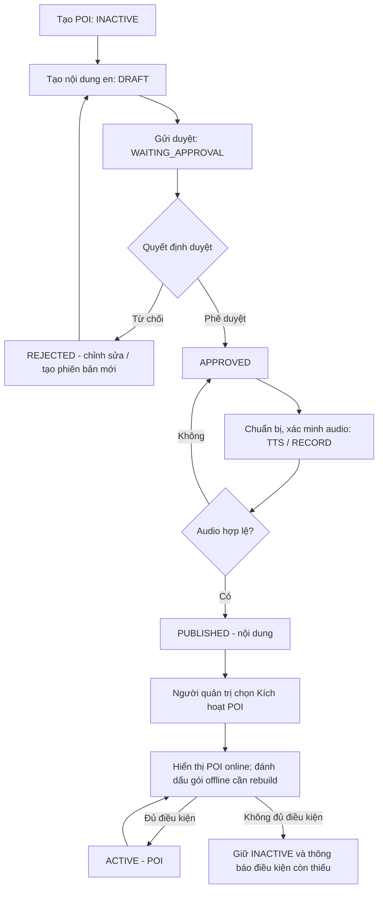

# UC-WEB-POI-01 — Tạo POI đến khi xuất bản và kích hoạt

> **Phân biệt hai nghiệp vụ:** **Publish** đưa *phiên bản nội dung thuyết minh* sang `PUBLISHED`; còn **Kích hoạt POI** đưa *điểm tham quan* từ `INACTIVE` sang `ACTIVE`. Đây là hai trạng thái độc lập. Một POI mới không tự hiển thị công khai chỉ vì đã tạo hoặc đã Publish nội dung.

| Trường | Nội dung / thao tác người dùng | Phản hồi hệ thống |
| :--- | :--- | :--- |
| Use case number: | UC-WEB-POI-01 |  |
| **Use case name:** | Tạo POI, biên soạn, phê duyệt, xuất bản nội dung và kích hoạt POI |  |
| **Actor(s):** | Người quản trị có quyền quản lý POI; Người biên soạn nội dung; Người kiểm duyệt/phê duyệt; Người có quyền Publish/kích hoạt POI. Một tài khoản có thể đảm nhiệm nhiều vai trò nếu được phân quyền. |  |
| **Maturity:** | Specified — đặc tả nghiệp vụ trước khi triển khai, không trình bày API kỹ thuật. |  |
| **Summary:** | Tạo POI mới ở trạng thái INACTIVE, soạn nội dung thuyết minh tiếng Anh, gửi duyệt, phê duyệt, chuẩn bị audio và Publish nội dung; sau đó quản trị viên kích hoạt POI thành ACTIVE khi đủ điều kiện. |  |
| **Basic Course of Events:** | **Actor action** | **System response** |
|  | 1. Người quản trị có quyền mở **Quản lý điểm tham quan (POI)** và chọn **Thêm POI**. | 2. Hệ thống hiển thị biểu mẫu gồm tên POI, khu vực, danh mục, địa chỉ/vị trí, tọa độ, bán kính Geofence, ảnh đại diện và mã QR. |
|  | 3. Người quản trị nhập thông tin và chọn **Lưu POI**. **E1, E2** | 4. Hệ thống kiểm tra và lưu POI mới với trạng thái **INACTIVE**, hiển thị “Tạo điểm tham quan thành công.” **E3** |
|  | 5. Người biên soạn mở POI vừa tạo, chọn **Thêm nội dung thuyết minh**, chọn ngôn ngữ **tiếng Anh (en)**, nhập tiêu đề và kịch bản thuyết minh. | 6. Hệ thống lưu nội dung phiên bản đầu ở trạng thái **DRAFT**; khi người biên soạn chọn **Gửi duyệt**, hệ thống kiểm tra thông tin bắt buộc. **A1, E4** |
|  | 7. Người biên soạn xác nhận **Gửi duyệt**. | 8. Hệ thống chuyển nội dung sang **WAITING_APPROVAL**, hiển thị “Đã gửi nội dung để phê duyệt.” và đưa nội dung vào danh sách chờ duyệt. |
|  | 9. Người có quyền duyệt mở nội dung chờ duyệt, kiểm tra và chọn **Phê duyệt**. **A2, E5** | 10. Hệ thống chuyển nội dung sang **APPROVED**, hiển thị “Phê duyệt nội dung thành công.” **A5** |
|  | 11. Người có quyền xuất bản chọn **Publish** và nguồn audio: **TTS** hoặc **tệp thu âm**. **A3, E5, E6** | 12. Hệ thống tạo hoặc tiếp nhận audio, lưu tệp và kiểm tra tài nguyên âm thanh hợp lệ trước khi công bố. **E7** |
|  |  | 13. Hệ thống chuyển nội dung sang **PUBLISHED** sau khi audio sẵn sàng, hiển thị “Xuất bản nội dung thành công.”; nếu đã có phiên bản PUBLISHED của cùng ngôn ngữ thì chuyển phiên bản cũ sang **ARCHIVED**. **E8** |
|  | 14. Người quản trị mở trang chi tiết POI sau khi xuất bản nội dung; có thể bổ sung nội dung bằng các ngôn ngữ khác. **A4** | 15. Hệ thống hiển thị trạng thái POI đang **INACTIVE** và thao tác **Kích hoạt POI** cho người có quyền. **A6** |
|  | 16. Người quản trị chọn **Kích hoạt POI**. | 17. **Hệ thống tự động kiểm tra** POI có ít nhất một nội dung **tiếng Anh (en)** ở trạng thái **PUBLISHED** và có **audio hợp lệ, sẵn sàng sử dụng**. Nếu đạt yêu cầu, hệ thống chuyển POI sang **ACTIVE** và hiển thị “Kích hoạt điểm tham quan thành công.”; nếu không đạt, không kích hoạt và xử lý theo **E9**. Quản trị viên không phải tự kiểm tra điều kiện này. **E9, E10, A7** |
| **Alternative Paths:** | **A1 — Lưu nháp để hoàn thiện sau:** Tại bước 6, người biên soạn chọn “Lưu nháp” thay vì “Gửi duyệt”; hệ thống giữ nội dung ở trạng thái DRAFT và hiển thị “Đã lưu bản nháp.”; quay lại bước 5 khi muốn tiếp tục hoặc kết thúc luồng.  **A2 — Bị từ chối và chỉnh sửa nội dung:** Tại bước 9, người duyệt chọn “Từ chối”, nhập lý do; hệ thống chuyển nội dung sang REJECTED, thông báo “Nội dung không được phê duyệt. Vui lòng xem lý do và chỉnh sửa.”; quay lại bước 5 để người biên soạn sửa và gửi duyệt lại. Nếu nội dung đã gắn audio thì tạo phiên bản nội dung mới thay vì sửa trực tiếp bản đó.  **A3 — Sử dụng audio thu âm có sẵn:** Tại bước 11, nếu quản trị viên chọn tệp thu âm thay vì tạo giọng đọc tự động, hệ thống tiếp nhận, kiểm tra định dạng và tính hợp lệ của tệp; nếu hợp lệ, tiếp tục bước 12.  **A4 — Bổ sung các ngôn ngữ khác:** Tại bước 14, người biên soạn có thể tạo nội dung cho ngôn ngữ khác theo cùng chu trình soạn thảo, gửi duyệt và Publish, không làm mất phiên bản tiếng Anh đang PUBLISHED; quay lại bước 5 cho từng nội dung mới hoặc kết thúc nhánh mở rộng.  **A5 — POI có nhiều phiên bản nội dung:** Tại bước 10, nếu POI đã có nội dung PUBLISHED cùng ngôn ngữ, nội dung mới được lưu thành phiên bản riêng; sau khi phiên bản mới Publish thành công tại bước 13, phiên bản cũ chuyển thành ARCHIVED; tiếp tục bước 14.  **A6 — Chưa muốn kích hoạt POI:** Tại bước 15, nếu người quản trị chưa chọn “Kích hoạt POI”, POI tiếp tục ở trạng thái INACTIVE dù đã có nội dung PUBLISHED; quay lại bước 14 hoặc kết thúc luồng.  **A7 — Phiên bản mới cần cập nhật gói offline:** Tại bước 17, nếu nội dung hoặc thông tin POI mới ảnh hưởng đến gói offline, hệ thống đánh dấu các gói liên quan cần xây dựng lại; bản đã phát hành vẫn được cung cấp cho đến khi có phiên bản gói mới hợp lệ. Việc tải/cập nhật gói trên mobile chỉ diễn ra khi du khách chủ động chọn; kết thúc luồng. |  |
| **Exception Paths:** | **E1 — Thông tin POI không hợp lệ:** Tại bước 3, nếu thiếu tên, khu vực, địa chỉ, ảnh, tọa độ hoặc bán kính kích hoạt không hợp lệ, hệ thống chỉ rõ trường cần sửa và hiển thị “Vui lòng kiểm tra thông tin điểm tham quan.”; quay lại bước 2.  **E2 — Địa chỉ hoặc mã QR bị trùng:** Tại bước 3, nếu địa chỉ hoặc mã QR đã tồn tại trong hệ thống, hệ thống không tạo POI trùng và hiển thị “Địa chỉ hoặc mã QR đã được sử dụng.”; quay lại bước 2.  **E3 — Không thể lưu POI:** Tại bước 4, nếu lưu thông tin POI thất bại, hệ thống hiển thị “Không thể tạo điểm tham quan. Vui lòng thử lại.”, không xác nhận tạo thành công; quay lại bước 2.  **E4 — Thiếu nội dung hoặc nội dung không hợp lệ:** Tại bước 6, nếu thiếu tiêu đề, kịch bản thuyết minh hoặc chưa chọn ngôn ngữ, hệ thống hiển thị “Vui lòng hoàn thiện nội dung thuyết minh trước khi gửi duyệt.”; quay lại bước 5.  **E5 — Không có quyền kiểm duyệt hoặc xuất bản:** Tại bước 9 hoặc bước 11, nếu tài khoản không được cấp quyền thao tác tương ứng, hệ thống hiển thị “Bạn không có quyền thực hiện thao tác này.” và giữ nguyên trạng thái nội dung; quay lại bước 8 hoặc kết thúc luồng.  **E6 — Nội dung chưa được duyệt:** Tại bước 11, nếu nội dung chưa đạt trạng thái APPROVED, hệ thống không cho Publish và hiển thị “Nội dung cần được phê duyệt trước khi xuất bản.”; quay lại bước 8.  **E7 — Tạo hoặc tải audio thất bại:** Tại bước 12, nếu tạo giọng đọc tự động, tải audio lên hoặc xác minh tệp không thành công, hệ thống hiển thị “Không thể chuẩn bị âm thanh. Vui lòng thử lại.”, giữ nội dung ở APPROVED và không thay phiên bản PUBLISHED đang có; quay lại bước 11.  **E8 — Publish không thành công:** Tại bước 13, nếu không thể hoàn tất việc xuất bản, hệ thống hiển thị “Xuất bản nội dung thất bại. Vui lòng thử lại.”, không chuyển nội dung thành PUBLISHED khi audio chưa sẵn sàng và giữ phiên bản hiện hành; quay lại bước 11.  **E9 — POI chưa đủ điều kiện kích hoạt:** Tại bước 17, nếu **hệ thống tự kiểm tra** và phát hiện POI không có nội dung tiếng Anh PUBLISHED hoặc audio tiếng Anh không hợp lệ/chưa sẵn sàng, hệ thống không kích hoạt, giữ POI ở INACTIVE và hiển thị “Không thể kích hoạt POI. Cần có ít nhất một nội dung tiếng Anh đã xuất bản và âm thanh hợp lệ.”; quay lại bước 15 để người quản trị bổ sung nội dung hoặc thử lại sau.  **E10 — Không thể kích hoạt POI:** Tại bước 17, nếu không thể lưu trạng thái kích hoạt, hệ thống hiển thị “Không thể kích hoạt điểm tham quan. Vui lòng thử lại.”, giữ POI INACTIVE; quay lại bước 15. |  |
| **Extension Points:** | Cập nhật nội dung theo phiên bản; thêm nhiều ngôn ngữ; thay audio, vô hiệu hóa POI, tái tạo gói offline và quản lý danh sách nội dung đã xuất bản. |  |
| **Triggers:** | Người quản trị chọn “Thêm POI” để xây dựng một điểm tham quan mới. |  |
| **Assumptions:** | Người dùng quản trị đã đăng nhập và được phân quyền; danh mục khu vực/ngôn ngữ có sẵn; hệ thống có nơi lưu ảnh, audio và phương án tạo TTS hoặc nhận bản thu âm. Trạng thái PUBLISHED thuộc nội dung; ACTIVE thuộc POI. |  |
| **Preconditions:** | Có tài khoản quản trị hợp lệ; khu vực và danh mục cần dùng đã tồn tại; hệ thống cho phép lưu dữ liệu POI và nội dung. |  |
| **Post Conditions:** | **Thành công:** POI ACTIVE và có ít nhất một nội dung en PUBLISHED với audio hợp lệ, có thể được phân phối cho mobile online; gói offline sẽ được xây dựng/cập nhật theo quy trình riêng. **Chưa hoàn tất:** POI INACTIVE; nội dung có thể còn DRAFT, WAITING_APPROVAL, REJECTED hoặc APPROVED; không công bố nội dung chưa PUBLISHED. |  |
| **Preferences:** | Thông báo cụ thể ở từng bước; không công bố audio thiếu/hỏng; nội dung đã Publish trước đó tiếp tục hoạt động khi phiên bản mới đang duyệt hoặc thất bại; không tự chuyển POI ACTIVE khi Publish nội dung. |  |
| **Author(s):** | MNR Documentation Team |  |
| **Date:** | 10-11-2026 |  |

## Sơ đồ trạng thái nghiệp vụ

## Quy tắc nghiệp vụ cần ghi nhớ

1. POI mới được tạo ở trạng thái **INACTIVE**; chỉ POI **ACTIVE** được cung cấp trong dữ liệu POI công khai online.
2. Trạng thái nội dung lần lượt gồm `DRAFT`, `WAITING_APPROVAL`, `REJECTED`, `APPROVED`, `PUBLISHED`, `ARCHIVED`. Khi Publish phiên bản mới, phiên bản cũ cùng POI và ngôn ngữ được lưu ở `ARCHIVED`, không bị ghi đè trực tiếp.
3. Khi quản trị viên nhấn **Kích hoạt POI**, **hệ thống tự động kiểm tra** phải có ít nhất một bản nội dung tiếng Anh (en) đang **PUBLISHED** cùng audio hợp lệ; không yêu cầu người quản trị tự xác minh. Nếu thiếu điều kiện, hệ thống giữ POI **INACTIVE** và hiển thị lý do. Các ngôn ngữ khác có thể thêm sau.
4. Publish nội dung chỉ được thực hiện khi nội dung **APPROVED** và audio đã được tạo/tải lên, lưu và xác minh hợp lệ. Nếu TTS/upload lỗi, nội dung vẫn APPROVED, không tự Publish.
5. Với bản `DRAFT` hoặc `REJECTED` đã liên kết audio, muốn thay đổi nội dung phải tạo **phiên bản mới đầy đủ** thay vì sửa trực tiếp phiên bản đã gắn audio.
6. **Publish nội dung không tự kích hoạt POI**. Quản trị viên thực hiện thao tác kích hoạt riêng sau khi hệ thống kiểm tra điều kiện.
7. Khi POI/nội dung mới được Publish hoặc kích hoạt, dữ liệu online có thể được cập nhật; các **gói offline** chịu ảnh hưởng phải được xây dựng lại và xuất bản theo quy trình riêng. Ứng dụng mobile **không tự tải bản cập nhật**, mà hiển thị cập nhật để du khách chủ động nhấn **“Cập nhật”**.
8. Bán kính **Geofence** lưu cùng POI dùng để tự phát thuyết minh; không phải bán kính khám phá **5 km** của màn Map mobile.

## Tiêu chí kiểm thử chính

- Tạo POI hợp lệ: trạng thái mặc định INACTIVE, không xuất hiện trên danh sách POI công khai.
- Thiếu tên, ảnh, khu vực, tọa độ, bán kính hoặc trùng địa chỉ/QR: không cho lưu và có thông báo rõ ràng.
- Gửi duyệt và phê duyệt: nội dung đi qua WAITING_APPROVAL rồi APPROVED; từ chối có thể chỉnh sửa/gửi lại hợp lệ.
- Publish khi chưa APPROVED hoặc audio bị lỗi: bị chặn; không mất nội dung PUBLISHED cũ.
- Publish thành công: nội dung PUBLISHED và audio hợp lệ; POI vẫn INACTIVE cho tới khi người quản trị kích hoạt.
- Khi nhấn Kích hoạt, hệ thống tự kiểm tra en PUBLISHED và audio hợp lệ: thiếu điều kiện thì bị từ chối với thông báo rõ ràng; đủ điều kiện mới chuyển ACTIVE.
- Thêm phiên bản mới: không làm gián đoạn phiên bản đã Publish; phiên bản cũ được ARCHIVED khi phiên bản mới Publish thành công.
- Sau khi kích hoạt: POI hiển thị online, các gói offline liên quan được chuẩn bị lại; mobile không tự cập nhật gói.

## Nguồn đối chiếu

- `PRD.md`: **FR-W02**, **FR-W03**, **FR-B03**, **FR-B04**; **BR-02**, **BR-03**, **BR-04**, **BR-09**; **US-W01**, **US-W03–US-W08**.
- `docs/database-design.md`: **2.2.1 Point_Of_Interests**, **2.2.3 Poi_Contents**, **2.2.4 Content_Audios**, cơ chế version và Publish/TTS.
- `docs/usecase/offline-content-download.md`: mobile chỉ tải/cập nhật gói offline khi du khách chủ động thực hiện.

**Phạm vi:** Đây là Use Case nghiệp vụ end-to-end cho đồ án sinh viên; các chức năng chi tiết như danh sách POI, sửa POI, phiên bản nội dung và quản lý audio có thể tách thành Use Case con khi cần. Các câu thông báo là nội dung đề xuất để triển khai giao diện quản trị.