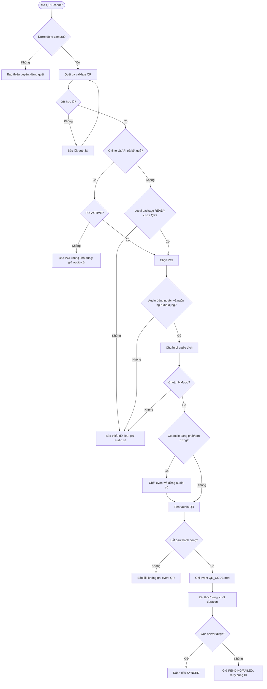

# UC-MOBILE-QR-01 — Chủ động quét QR và phát thuyết minh

| Use case number: | UC-MOBILE-QR-01 |  |
| :---- | :---- | :---- |
| **Use case name:** | Quét QR chủ động và phát thuyết minh tại POI |  |
| **Actor(s):** | Khách du lịch (Tourist); tác nhân hỗ trợ: Mobile Application, Camera, Narration Player và hệ thống nội dung/lịch sử nghe |  |
| **Maturity:** | Specified — quy tắc nghiệp vụ mục tiêu của đồ án; chưa xác nhận tất cả đã được triển khai |  |
| **Summary:** | Du khách chủ động quét QR tại POI để nghe thuyết minh. Sau khi xác thực QR, POI và audio hợp lệ, hệ thống **ưu tiên yêu cầu phát QR**: dừng và thay thế audio đang phát, không chờ hết bài cũ. Hỗ trợ nguồn online hoặc package offline READY, lưu lịch sử nghe `QR_CODE` trên thiết bị và đồng bộ khi có mạng. |  |
| **Basic Course of Events:** | **Actor action** | **System response** |
|  | 1\. Du khách mở chức năng **Quét QR** tại điểm tham quan. |  |
|  |  | 2\. Ứng dụng yêu cầu quyền camera (nếu chưa có) và mở màn hình quét. **E1** |
|  | 3\. Du khách đưa mã QR vào vùng quét. |  |
|  |  | 4\. Ứng dụng đọc mã, kiểm tra định dạng và ngăn xử lý nhiều lần cùng một mã trong khi yêu cầu trước chưa hoàn tất. **E2** |
|  |  | 5\. Ứng dụng xác định POI: khi online, gửi payload tới `POST /api/v1/pois/qr/resolve` để backend xác thực QR, POI **ACTIVE** và narration có audio; nếu mất kết nối hoặc truy vấn thất bại, tra cứu `poi_qr_code` trong dữ liệu offline thuộc package **READY**. **A1, A2, E3, E4** |
|  |  | 6\. Ứng dụng kiểm tra nội dung và âm thanh thuyết minh phù hợp với ngôn ngữ người dùng: ưu tiên audio local **VERIFIED**; nếu không có và đang online, dùng audio **PUBLISHED** hợp lệ, có thể fallback tiếng Anh theo quy tắc online. **A3, E5** |
|  |  | 7\. Ứng dụng xác nhận audio đích đã sẵn sàng để bắt đầu. Nếu player đang phát hoặc tạm dừng nội dung khác, chốt thời lượng nghe của phiên cũ, dừng và thay thế phiên cũ bằng nội dung QR. **A4, E6** |
|  |  | 8\. Ứng dụng bắt đầu phát audio của POI vừa quét, hiển thị tên POI và điều khiển phát. Chỉ khi audio thực sự bắt đầu, tạo một lịch sử nghe mới với `trigger_type = QR_CODE`. **E7** |
|  | 9\. Du khách nghe thuyết minh; có thể tạm dừng, tiếp tục hoặc dừng phát. |  |
|  |  | 10\. Ứng dụng ghi thời lượng phát thực tế, thời điểm kết thúc/dừng và lưu lịch sử nghe trên thiết bị. |
|  |  | 11\. Khi có Internet, ứng dụng đồng bộ lịch sử nghe chưa gửi lên hệ thống; chỉ đánh dấu đã đồng bộ khi nhận xác nhận thành công. **A5, E8** |
|  |  | 12\. Hệ thống tiếp tục theo dõi Geofence nếu người dùng đã bật; không phát chồng và không tự khôi phục audio đã bị QR thay thế. **A6** |
| **Alternative Paths:** | **A1 — Quét QR khi online:** Tại bước 5, nếu hệ thống trực tuyến phản hồi, ứng dụng chỉ chấp nhận POI đang ACTIVE; tiếp tục bước 6.  **A2 — Quét QR khi offline:** Tại bước 5, nếu mất mạng hoặc không thể tra cứu trực tuyến nhưng có package READY chứa mã QR và POI hợp lệ trong snapshot, ứng dụng dùng dữ liệu đã tải và có thể hiện thông báo “Đang sử dụng nội dung đã tải xuống.”; tiếp tục bước 6.  **A3 — Lựa chọn nguồn audio:** Tại bước 6, nếu có audio local VERIFIED đúng ngôn ngữ thì dùng file local; nếu không có nhưng online thì tìm audio PUBLISHED của ngôn ngữ chọn, sau đó fallback tiếng Anh nếu cần. Offline không tự fallback sang ngôn ngữ khác; tiếp tục bước 7.  **A4 — QR thay thế audio đang phát:** Tại bước 7, nếu đang phát hoặc tạm dừng thuyết minh khác (tự động, QR hoặc thủ công), hệ thống chốt thời lượng phiên cũ, dừng audio cũ và phát audio QR mới; tiếp tục bước 8. Không tự phát lại bài cũ sau khi QR kết thúc.  **A5 — Đồng bộ lịch sử khi có mạng trở lại:** Tại bước 11, nếu trước đó offline, ứng dụng gửi các sự kiện PENDING/FAILED bằng đúng ID đã lưu, chuyển sang SYNCED khi server xác nhận; kết thúc lượt đồng bộ.  **A6 — Đang có Geofence chờ phát:** Tại bước 12, nếu có candidate tự động đang chờ, ứng dụng không cho candidate đó ngắt audio QR. Sau khi QR kết thúc, chỉ xét candidate nếu vị trí, entry và cooldown còn hợp lệ; quay lại quy trình Geofence độc lập, kết thúc luồng QR. |  |
| **Exception Paths:** | **E1 — Không cấp quyền camera:** Tại bước 2, nếu camera bị từ chối hoặc không khả dụng, hiển thị “Không thể sử dụng camera. Vui lòng cấp quyền camera hoặc chọn điểm tham quan thủ công.”; kết thúc luồng quét.  **E2 — QR không hợp lệ:** Tại bước 4, nếu mã không đúng định dạng hoặc không thuộc hệ thống, hiển thị “Mã QR không hợp lệ. Vui lòng quét lại.”; quay lại bước 3.  **E3 — POI không khả dụng:** Tại bước 5, nếu tra cứu trực tuyến xác định POI đã INACTIVE, không tồn tại hoặc không được công khai, hiển thị “Điểm tham quan này hiện không khả dụng.”; quay lại bước 3. Không sử dụng snapshot cũ để vượt quyết định từ server.  **E4 — Không thể tìm POI khi offline:** Tại bước 5, nếu không thể tra cứu trực tuyến và không có package READY chứa mã QR, hiển thị “Không tìm thấy nội dung đã tải cho mã QR này. Vui lòng kết nối Internet để thử lại.”; quay lại bước 3 hoặc kết thúc luồng.  **E5 — Không có audio hợp lệ:** Tại bước 6, nếu không có audio local VERIFIED đúng ngôn ngữ và cũng không lấy được audio PUBLISHED online, hiển thị “Chưa có thuyết minh khả dụng cho điểm tham quan này.”; giữ nguyên audio đang phát trước đó (nếu có), quay lại bước 3.  **E6 — Không thể chuẩn bị audio mới:** Tại bước 7, nếu không thể xác nhận audio đích có thể bắt đầu, hiển thị “Không thể chuẩn bị thuyết minh. Vui lòng thử lại.”; không dừng audio cũ, quay lại bước 3.  **E7 — Phát audio QR thất bại:** Tại bước 8, nếu player không bắt đầu được sau khi đã chuyển nguồn, hiển thị “Không thể phát thuyết minh. Vui lòng thử lại.”; không tạo lượt nghe QR thành công giả, giải phóng player và kết thúc nhánh phát.  **E8 — Đồng bộ lịch sử nghe thất bại:** Tại bước 11, nếu không có Internet, máy chủ lỗi hoặc mất phản hồi xác nhận, giữ lịch sử ở PENDING/FAILED và thử lại bằng cùng ID khi có mạng; không tạo bản ghi trùng, kết thúc lượt đồng bộ hiện tại. |  |
| **Extension Points:** | Có thể bổ sung lựa chọn ngôn ngữ ngay sau quét QR hoặc xem trang chi tiết trước khi phát; mặc định theo yêu cầu này là **quét hợp lệ → tự chuyển sang phát**. |  |
| **Triggers:** | Du khách chọn chức năng quét QR và đưa mã của một POI vào camera. |  |
| **Assumptions:** | QR xác định POI; backend trả POI ACTIVE và nội dung PUBLISHED cho truy vấn online; package offline hợp lệ phải ở trạng thái READY và chứa ánh xạ `poi_qr_code` đến POI; audio local cần VERIFIED. |  |
| **Preconditions:** | Ứng dụng hoạt động, người dùng có thể mở tính năng QR; có quyền camera (hoặc cho phép cấp khi bắt đầu). Không yêu cầu người dùng đăng nhập, cấp GPS hay bật auto narration. |  |
| **Post Conditions:** | **Thành công:** Một audio QR được phát, audio cũ (nếu có) đã dừng và được chốt lịch sử, một lịch sử nghe mới `QR_CODE` được lưu và đồng bộ khi có mạng. **Thất bại trước khi chuyển nguồn:** Không làm gián đoạn audio cũ; không tạo lịch sử nghe QR giả. **Thất bại sau chuyển nguồn:** Player báo lỗi, không tự phát lại bài cũ. |  |
| **Preferences:** | QR chủ động **được quyền thay thế** bất kỳ narration đang phát/tạm dừng; không phát chồng; không áp cooldown AUTO_LOCATION cho QR; không thay thế audio đang phát trước khi xác định audio đích sẵn sàng; không dùng file offline chưa VERIFIED; không tạo lịch sử nghe trùng khi retry. |  |
| **Author(s):** | MNR Documentation Team |  |
| **Date:** | 10-11-2026 |  |

## Quy tắc ưu tiên khi quét QR

1. **Quét QR hợp lệ là hành động chủ động.** Không cần đợi hết nội dung đang phát và không bị chặn bởi cooldown 5 phút dành cho Geofence tự động.
2. **Xác minh trước khi ngắt.** Đọc QR, xác định POI, kiểm tra nguồn audio phù hợp và khả năng khởi chạy trước khi dừng phiên cũ. QR sai hoặc thiếu nội dung không làm mất bài đang nghe.
3. **Khi chuyển bài:** chốt `completed_at` và `duration_sec` theo thời gian phát thực tế của phiên cũ (kể cả khi đang PAUSED), rồi dừng player cũ; bắt đầu bài mới. Nếu bài cũ là AUTO_LOCATION, cooldown đã ghi vẫn giữ nguyên.
4. **Khi bài QR bắt đầu:** ghi sự kiện mới có ID riêng, `trigger_type = QR_CODE` và `started_at` tại thời điểm thực sự phát; không dùng `AUTO_LOCATION` cho lượt nghe này.
5. **Không khôi phục bài cũ tự động.** Khi QR kết thúc, audio bị thay thế không tự phát tiếp; Geofence vẫn có thể theo dõi nhưng phải kiểm tra lại các điều kiện trước khi tự phát.

## Nguồn dữ liệu và kết nối

| Trạng thái khi quét | Ứng xử |
| --- | --- |
| Có mạng và server phản hồi POI ACTIVE | Ưu tiên xác nhận POI từ server. Dùng audio local VERIFIED nếu phù hợp; nếu không thì dùng audio online PUBLISHED. |
| Có mạng nhưng server tạm không phản hồi; có package READY | Có thể dùng snapshot offline chứa mã QR, cảnh báo dữ liệu có thể cũ. |
| Không có mạng; có package READY chứa POI và audio VERIFIED đúng ngôn ngữ | Quét và phát từ thiết bị; event lịch sử ở PENDING. |
| Không có mạng; không có READY/không có audio đúng ngôn ngữ | Không chuyển nguồn, giữ audio cũ, hiển thị thông báo thiếu dữ liệu. |
| Server phản hồi POI đã INACTIVE/không tồn tại | Không fallback về snapshot cũ để bỏ qua trạng thái do server xác nhận. |
| Có mạng, chưa có nội dung ngôn ngữ yêu cầu | Theo BR-05, có thể fallback tiếng Anh nếu audio PUBLISHED hợp lệ; offline không tự fallback khác ngôn ngữ. |

## Ghi và đồng bộ lịch sử nghe

- **Phiên bị QR thay thế:** lưu thời lượng thực tế và kết thúc sự kiện cũ; không xóa bản ghi cũ hoặc đổi `trigger_type` của nó.
- **Phiên QR mới:** chỉ khi phát bắt đầu mới tạo ID `listen-ddmmyy-xxxxxxxx`, gắn `installation_id`, `poi_id`, `poi_content_id`, `trigger_type = QR_CODE`, `started_at`. Khi dừng/kết thúc, ghi `completed_at` và `duration_sec`.
- **Offline:** lưu `Local_Listening_Events` với `sync_status = PENDING`. Khi online, lần lượt đồng bộ cả phiên cũ và phiên QR.
- **Retry:** gửi lại bằng **cùng ID** nếu timeout hoặc mất mạng; server xử lý idempotent. Chỉ sau khi có xác nhận mới đặt trạng thái `SYNCED`.

## Activity Diagram — QR chủ động thay thế audio

## Kịch bản kiểm thử tối thiểu

| ID | Kịch bản | Kết quả mong đợi |
| --- | --- | --- |
| TC-QR-01 | Audio AUTO_LOCATION đang phát; người dùng quét QR hợp lệ | Chốt audio cũ, dừng ngay và phát QR; cooldown cũ không đổi; không phát chồng. |
| TC-QR-02 | Audio QR đang PAUSED, quét QR khác | Chốt đúng thời lượng bài cũ và thay thế bằng bài mới. |
| TC-QR-03 | QR không hợp lệ hoặc thiếu audio | Báo lỗi; audio đang phát không bị ảnh hưởng. |
| TC-QR-04 | Mất mạng nhưng có package READY + audio VERIFIED | Phát offline, tạo event PENDING rồi sync lại. |
| TC-QR-05 | Mất mạng, chưa có package READY | Báo cần tải dữ liệu, không ngắt audio cũ. |
| TC-QR-06 | Server trả POI INACTIVE | Từ chối phát, không fallback snapshot cũ. |
| TC-QR-07 | Sync event timeout sau khi server lưu | Retry cùng ID, không tạo bản ghi trùng. |

**Ghi chú:** PRD FR-M04/US-M09 quy định quét QR để truy cập nội dung; quy tắc **quét hợp lệ tự chuyển sang phát và ưu tiên ngắt audio đang phát** được bổ sung theo yêu cầu nghiệp vụ của nhóm. Các chi tiết luồng dữ liệu dựa trên `docs/database-design.md` và quy tắc online/offline của PRD.
